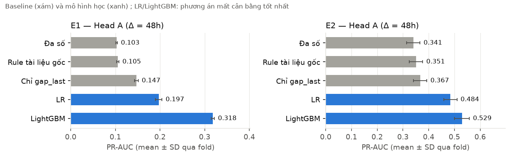
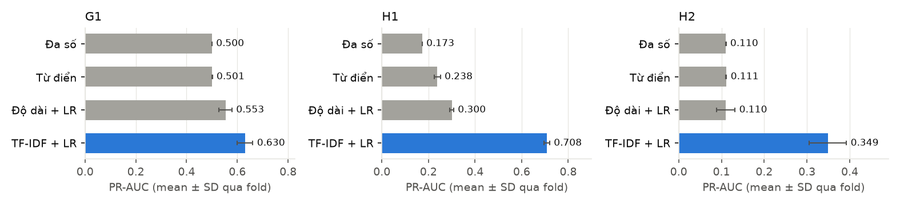
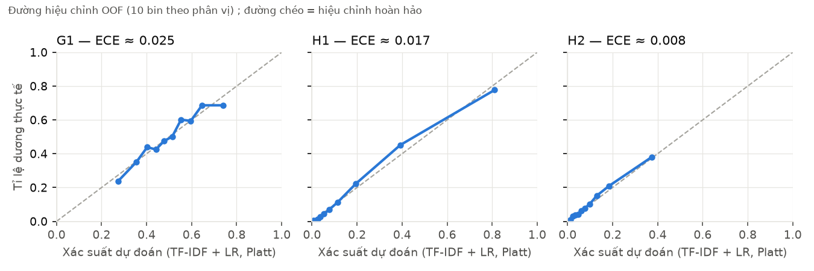
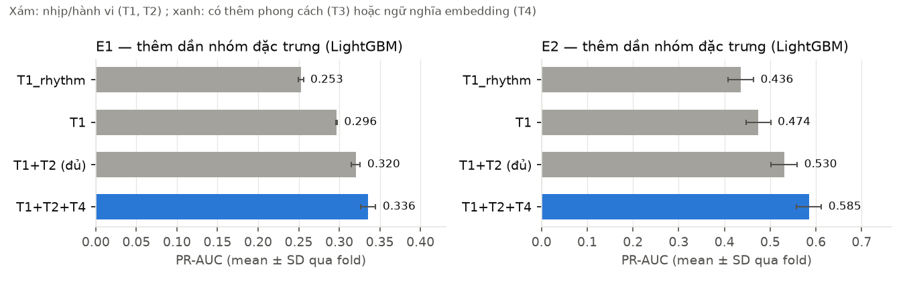
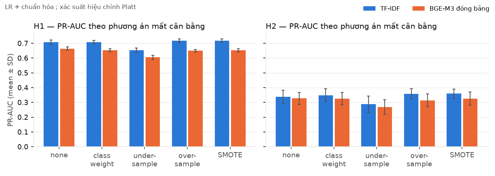

# Báo cáo Module 3 — Conversation Intelligence (BẢN NHÁP A10)

> **Trạng thái 06/11/2026:** nháp từ kết quả CV/OOF trên **tập train**. Tập test **chưa mở** (A mở đúng 1 lần ngày 20/11).
> Ô ghi `[TEST 20/11]` điền sau A8 ; ô ghi `[CHỜ Bx/Cx]` điền khi việc của B/C xong. Mọi con số dưới đây lấy từ
> `docs/results/*.md` (sinh bằng script, có dòng trong `experiments/ledger.csv`) — sửa số thì chạy lại script, không sửa tay.
> Khung mục theo `01_CHUAN_BAO_CAO_AUDITABLE.md` §4 ; thiết kế đầy đủ ở `06_MODULE_3_HEALTH_MONITOR.md`.
> Phân công viết: A — 3.1–3.5 khung + Head A + tổng hợp ; B — mô tả dữ liệu (B7) ; C — Head B nội dung + T3–T5 (C7).

## Tóm tắt

Hai bài toán dự báo trên hội thoại người–người, chỉ dùng thông tin tới thời điểm hiện tại:

- **Head A — hội thoại sắp "tắt"**: P(không ai nhắn tiếp trong Δ = 48h). Hai bộ có timestamp: Ubuntu IRC (E1) và Twitter CSKH (E2).
- **Head B — hội thoại sắp thành công kích / tin độc hại**: dự báo trên Conversations Gone Awry (G1, tiếng Anh) và phân loại bình luận độc hại tiếng Việt ViHSD (H1), ViCTSD (H2).

Kết quả chính trên CV của train (mean ± SD qua 5 fold):

| | Baseline mạnh nhất | Mô hình chốt | PR-AUC chốt | Vận hành |
|---|---|---|---|---|
| E1 | `gap_last` 0.147 ± 0.004 | LightGBM + class_weight | **0.318 ± 0.004** | top 10%: precision 0.345, recall 0.343, lift 3.3× |
| E2 | `gap_last` 0.367 ± 0.026 | LightGBM + SMOTE | **0.529 ± 0.029** | top 10%: precision 0.620, recall 0.193, lift 1.9× |
| G1 | độ dài tiền tố 0.553 ± 0.026 | TF-IDF + LR | **0.631 ± 0.031** | FPR 5%: recall 0.100 |
| H1 | độ dài 0.300 ± 0.008 | TF-IDF + LR | **0.708 ± 0.013** | FPR 5%: recall 0.583 |
| H2 | độ dài 0.110 ± 0.022 | TF-IDF + LR | **0.349 ± 0.044** | FPR 5%: recall 0.297 |

Các phát hiện chính:

- Nhịp trả lời (T1_rhythm) là nhóm đặc trưng quan trọng nhất.
- Xử lý mất cân bằng gần như không đổi PR-AUC, nhưng làm hỏng calibration nếu không hiệu chỉnh lại.
- Mô hình **không chuyển được** giữa hai nền tảng (E1 → E2: ROC-AUC 0.50).
- Phần lớn ca báo đúng chỉ được báo ở tin cuối, tức lead time ngắn.
- Head B tiếng Việt "buộc tội oan" các câu chửi thề cảm thán, vì ViHSD gán nhãn như vậy. Đây là lệch định nghĩa, không phải lỗi mô hình.

---

## 3.1 Objective and data

**Deployment target.**
- *Head A:* trong app FwP, tại mỗi tin nhắn (và mỗi giờ với hội thoại đang im), ước lượng xác suất đã hiệu chỉnh p = P(không có tin mới trong 48h | lịch sử tới t). App hiện 3 mức: khỏe (p < τ1), hời hợt (τ1 ≤ p < τ2), nguy cơ (p ≥ τ2). Ở mức nguy cơ, app gợi ý riêng tư cho người dùng.
- *Head B:* tại mỗi tin, ước lượng P(hội thoại sẽ có công kích ở lượt tới) và điểm độc hại của tin đang soạn. Dùng để **nhắc nhẹ người gửi**, không tự động phạt.

**Dữ liệu** (chỉ dataset công khai ; nhóm không thu dữ liệu thật). Chi tiết ở `docs/data_cards/`.

| ID | Dataset | Nguồn / license | Train: N mẫu / N đơn vị độc lập | Test: N mẫu / N đơn vị | Prevalence train / test | Đơn vị độc lập |
|---|---|---|---|---|---|---|
| E1 | Ubuntu Dialogue Corpus (IRC, 2 người) | Kaggle `rtatman/ubuntu-dialogue-corpus` ; "other", nghiên cứu | 2,029,147 / 360,218 hội thoại | 497,882 / 90,054 | 0.104 / 0.102 | hội thoại |
| E2 | Customer Support on Twitter | Kaggle `thoughtvector/customer-support-on-twitter` ; CC BY-NC-SA 4.0 | 125,794 / 56,318 khách hàng | 26,803 / 14,079 | 0.334 / 0.332 | khách hàng |
| G1 | Conversations Gone Awry — Wikipedia | ConvoKit ; CC BY-SA | 3,348 / 1,446 trang | 840 / 370 | 0.500 / 0.500 (ghép cặp) | trang (giữ cặp) |
| H1 | ViHSD | HF `uitnlp/vihsd` ; MIT | 26,719 / 24,452 nhóm nội dung | 6,681 / 6,116 | 0.173 / 0.173 | nội dung trùng |
| H2 | UIT-ViCTSD | HF `tarudesu/ViCTSD` ; nghiên cứu | 8,001 / 660 bài báo | 1,999 / 165 | 0.110 / 0.110 | bài báo |

- **Mẫu Head A:** mẫu là cặp (hội thoại, mốc t) tại tin thứ 6, 8, 10… Đặc trưng chỉ lấy từ tin ≤ t. Nhãn y = 1 nếu không có tin nào trong (t, t + 48h]. Mốc bị right-censor ở 48h bị loại khỏi bài nhị phân (E1: 97, E2: 1,736) nhưng vẫn giữ cho survival.
- **Vì sao chọn đơn vị độc lập như trên:**
  - Các mốc trong cùng hội thoại tự tương quan với nhau.
  - E2 có cùng một khách hàng ở nhiều hội thoại.
  - Ở G1, mỗi hội thoại "hỏng" được ghép với một hội thoại "lành" cùng trang.
  - Split gốc của H1/H2 bị rò rỉ: 802/6,680 bình luận test ViHSD trùng nội dung với train ; 974/1,000 bình luận test ViCTSD cùng bài báo với train. Vì vậy nhóm tự chia lại theo group.
- **Giới hạn tài nguyên:** CV Head A dùng 60,000 hội thoại lấy ngẫu nhiên (seed 42) từ train của mỗi bộ (`labels.cv_conversations`). Kết quả: E1 338,240 mẫu, E2 123,102 mẫu.

## 3.2 Evaluation design

| Phần | Head A (E1, E2) | Head B (G1) | Head B (H1, H2) |
|---|---|---|---|
| Test (khóa) | 20% hội thoại **bắt đầu muộn nhất** | split chuẩn ConvoKit (cặp ghép cùng phía) | 20% theo group |
| Outer CV | forward chaining K = 5 theo thời điểm bắt đầu group | group K-fold K = 5 (group = trang) | group K-fold K = 5 |
| Calibration | 20% group muộn nhất của mỗi outer-train (mô hình fit trên 80% còn lại) | 20% group của outer-train | như G1 |
| Seeds | 42 cho split test và mô hình ; R = 1 với LightGBM/LR. `[CHỜ B10]` R = 3 cho NN | 42 | 42 |
| Bootstrap | cluster theo hội thoại, B = 2000, percentile CI 95% ; so sánh mô hình bằng paired bootstrap | cluster theo trang | cluster theo group |

- **Chống rò rỉ:**
  - `assert_no_group_leak` và `assert_time_order` chạy ở mọi fold (`src/eval/splits.py`, test trong `tests/test_splits_no_leak.py`).
  - Scaler, TF-IDF, SMOTE và calibrator chỉ fit trên phần fit của fold.
  - Ngưỡng chọn trên OOF của train. Test chỉ dùng để báo cáo.
- **Khóa test:** băm danh sách group test nằm ở `configs/test_lock.json`. `load_train()` không bao giờ trả về test. Chỉ A mở test, ngày 20/11.

## 3.3 Learning procedure

```
messages → mẫu (c, t) + nhãn + cờ censor → đặc trưng T1+T2 (≤ t)
→ StandardScaler (LR) → [resampler: chỉ phần fit] → mô hình
→ prior shift về prevalence thật → calibrator (Platt / isotonic trên calibration) → τ
```

- **Đặc trưng:** 21 đặc trưng (`src/m3_health/features.py`):
  - T1_rhythm (9): số tin, tuổi hội thoại, các thống kê khoảng cách tin, burstiness.
  - T1_clock (3): giờ trong ngày, cuối tuần, ban đêm.
  - T1_asym (2): tỉ lệ người gửi tin cuối, double-text.
  - T2_surface (7): độ dài, tin cụt, câu hỏi.
  - T3 (B5): LSM trên từ chức năng, lexical mirroring, độ dài lượt / tỉ lệ đổi lượt, trong cửa sổ 10 tin kết thúc tại t ; giá trị thiếu là NaN + cờ thiếu. `[CHỜ C1/B8]` T4–T5: embedding BGE-M3 (chốt 06/11).
- **Candidate Head A:** đa số ; rule của tài liệu gốc ; chỉ `gap_last` ; LR ; LightGBM (300 cây, lr 0.05, 31 lá). Mỗi mô hình × 5 phương án mất cân bằng (none, class_weight, undersample, oversample, SMOTE). Survival: Cox PH, Random Survival Forest. TabPFN v2 (X7, B9): so với LightGBM trên cùng tập con 100/300/1.000 group của từng outer-train (TabPFN v2 giới hạn 10.000 dòng).
- **Candidate Head B:** đa số ; từ điển từ xúc phạm ; LR chỉ độ dài ; TF-IDF + LR (có và không có đặc trưng độ dài). `[CHỜ C2/C4]` PhoBERT/XLM-R, CRAFT-like.
- **Calibration:** Platt và isotonic, chọn theo Brier trên calibration. Prior shift đưa xác suất về prevalence thật trước khi hiệu chỉnh, vì resampling làm lệch xác suất.
- **Ngưỡng:**
  - *Head A τ2:* **ngân sách cảnh báo** top 10% điểm. Lý do: tỉ lệ chi phí 1 : 2 cho recall 0.4% trên E1 (gần như không bao giờ báo), và cùng một tỉ lệ chi phí lại cho tỉ lệ cảnh báo rất khác giữa E1 và E2 (`HEAD_A_COST.md`). Ngân sách cố định giữ số lần làm phiền mỗi người dùng ổn định khi prevalence thay đổi.
  - *Head A τ1:* recall ≥ 0.8, với τ1 ≤ τ2.
  - *Head B τ_B:* FPR ≤ 5%, vì báo nhầm nghĩa là buộc tội oan người dùng.

## 3.4 Results

### R1 — CV mean ± SD (train)

Bảng đủ mọi candidate ở `docs/results/HEAD_A_CV.md`, `HEAD_B_CV.md`. Rút gọn:

| Bộ | Mô hình | PR-AUC | ROC-AUC | Brier (isotonic) | ECE isotonic |
|---|---|---|---|---|---|
| E1 | rule (tài liệu gốc) | 0.105 ± 0.002 | 0.515 ± 0.004 | 0.092 ± 0.001 | 0.003 ± 0.003 |
| E1 | gap_last | 0.147 ± 0.004 | 0.583 ± 0.005 | 0.091 ± 0.001 | 0.003 ± 0.002 |
| E1 | LR | 0.197 ± 0.007 | 0.692 ± 0.009 | 0.088 ± 0.001 | 0.004 ± 0.001 |
| E1 | **LightGBM + class_weight** | **0.318 ± 0.004** | **0.827 ± 0.003** | 0.079 ± 0.002 | 0.004 ± 0.001 |
| E2 | rule | 0.351 ± 0.026 | 0.515 ± 0.005 | 0.224 ± 0.008 | 0.018 ± 0.011 |
| E2 | gap_last | 0.367 ± 0.026 | 0.557 ± 0.002 | 0.222 ± 0.008 | 0.015 ± 0.006 |
| E2 | LR | 0.484 ± 0.025 | 0.659 ± 0.005 | 0.209 ± 0.007 | 0.019 ± 0.006 |
| E2 | **LightGBM + SMOTE** | **0.529 ± 0.029** | **0.699 ± 0.005** | 0.200 ± 0.006 | 0.016 ± 0.004 |

| Bộ | Mô hình | PR-AUC | ROC-AUC | Precision / Recall / FPR @τ_B | CI 95% PR-AUC (cluster bootstrap OOF) |
|---|---|---|---|---|---|
| G1 | length_lr | 0.553 ± 0.026 | 0.572 ± 0.018 | 0.545 / 0.048 / 0.040 | — |
| G1 | **TF-IDF + LR** | **0.631 ± 0.031** | 0.654 ± 0.017 | 0.672 / 0.117 / 0.057 | [0.607, 0.647] |
| G1 | TF-IDF + LR, bỏ độ dài | 0.626 ± 0.023 | 0.651 ± 0.019 | 0.649 / 0.097 / 0.051 | — |
| H1 | lexicon | 0.238 ± 0.013 | 0.564 ± 0.009 | 0.608 / 0.148 / 0.020 | — |
| H1 | **TF-IDF + LR** | **0.708 ± 0.013** | 0.904 ± 0.004 | 0.715 / 0.576 / 0.048 | [0.691, 0.720] |
| H2 | **TF-IDF + LR** | **0.349 ± 0.044** | 0.779 ± 0.034 | 0.419 / 0.303 / 0.053 | [0.263, 0.421] |

- Mô hình thắng mọi baseline với khoảng cách lớn hơn nhiều lần SD. `[TEST 20/11]` paired bootstrap trên test để chốt "ngoài CI".
- G1: bỏ đặc trưng độ dài gần như không đổi PR-AUC (0.631 → 0.626). Như vậy mô hình học nội dung, không chỉ học "tiền tố hỏng dài hơn 0.5 lượt".







Xác suất Head B sau hiệu chỉnh Platt bám sát đường chéo (ECE theo 10 bin phân vị 0.008–0.025), nên ngưỡng τ_B và mức "nhắc nhẹ" trong app có thể đọc như xác suất thật.

### R2 — Ablation (X1, LightGBM + none ; `HEAD_A_ABLATION.md`)

| Tập đặc trưng | E1 PR-AUC | E2 PR-AUC |
|---|---|---|
| T1_rhythm | 0.253 ± 0.003 | 0.436 ± 0.028 |
| T1 | 0.296 ± 0.001 | 0.474 ± 0.027 |
| T1 + T2 | 0.320 ± 0.005 | 0.530 ± 0.029 |
| bỏ T1_rhythm | 0.181 ± 0.016 (Δ −0.140) | 0.476 ± 0.030 (Δ −0.054) |
| bỏ T1_clock | 0.322 ± 0.005 (Δ +0.001) | 0.529 ± 0.029 (Δ −0.001) |
| bỏ T1_asym | 0.280 ± 0.005 (Δ −0.041) | 0.490 ± 0.028 (Δ −0.040) |
| + T3 (phong cách: LSM, mirroring, turn-taking ; B5) | 0.327 ± 0.006 (Δ +0.007 ± 0.003) | 0.566 ± 0.030 (Δ +0.035 ± 0.004) |
| + T4 không T3 (BGE-M3 đóng băng: độ liên quan trả lời, topic drift / novelty, PCA 32 chiều) | 0.336 ± 0.009 (Δ +0.015 ± 0.004) | 0.585 ± 0.027 (Δ +0.054 ± 0.005) |
| + T3 + T4 | **0.337 ± 0.010** (Δ +0.017 ± 0.005) | **0.606 ± 0.026** (Δ +0.076 ± 0.004) |
| + T5 | `[CHỜ C4]` | |



**RQ1 (tạm):** nhịp trả lời quyết định nhiều nhất, sau đó là bất đối xứng hai bên và bề mặt văn bản ; giờ trong ngày không giúp gì. Phong cách T3 thêm +0.035 trên E2 nhưng chỉ +0.007 trên E1 ; ngữ nghĩa T4 giúp rõ trên E2 (+0.054 khi thêm riêng, gấp khoảng 10 lần SD của hiệu số) nhưng ít trên E1 (+0.015). Hai nhóm bổ sung cho nhau: T3 + T4 cho E2 0.606 (+0.076), E1 0.337 (+0.017) — hội thoại CSKH "tắt" theo nội dung (đã giải quyết xong), còn IRC tắt chủ yếu theo nhịp.

### R3 — Mất cân bằng (X2)

- **Head A** (`HEAD_A_CV.md`): 5 phương án cho PR-AUC chênh nhau ≤ 0.015, nằm trong khoảng 1 SD. Riêng undersample kém hơn một chút. SMOTE làm ECE thô tăng từ 0.006 lên 0.084 (E1) và từ 0.021 lên 0.128 (E2). Sau prior shift và isotonic thì ECE về khoảng 0.004 / 0.016. **Kết luận:** với LightGBM trên 10–33% dương, resampling không cải thiện xếp hạng. Bắt buộc phải hiệu chỉnh lại xác suất nếu dùng resampling.
- **Head B** (`IMBALANCE_B.md`, H2 prevalence 0.11):
  - Ở ngưỡng mặc định 0.5, "none" cho recall 0.009, tức gần như không bao giờ báo. class_weight / oversample / SMOTE nâng recall lên khoảng 0.40 nhưng FPR thành 8–10%.
  - Sau calibration và τ_B (FPR 5%), mọi phương án hội tụ về recall khoảng 0.30, trừ undersample còn 0.21.
  - Lặp lại với **embedding BGE-M3 đóng băng + LR** (SMOTE trên vector câu): cùng kết luận ; undersample vẫn kém nhất. Embedding đóng băng **kém hơn TF-IDF** ở H1 (PR-AUC 0.664 ± 0.011 so với 0.707 ± 0.015) và không hơn ở H2 (0.327 ± 0.041 so với 0.339 ± 0.045): độc hại phụ thuộc mạnh vào từ ngữ cụ thể, vector câu tổng quát làm mờ tín hiệu này → cần fine-tune (PhoBERT/XLM-R, `[CHỜ C2/B10]`).
  - **Kết luận:** lợi ích "thấy được" của resampling chủ yếu là dịch ngưỡng. Chọn ngưỡng đúng cách cho kết quả tương đương. `[CHỜ B10]` weighted loss / oversampling cho PhoBERT trên H2.



### R4 — Test (chạm 1 lần) `[TEST 20/11]`

| Bộ | Mô hình chốt | PR-AUC [CI 95%] | ROC-AUC [CI] | Brier | Precision / Recall @τ | So với baseline (paired bootstrap Δ PR-AUC [CI]) |
|---|---|---|---|---|---|---|
| E1 | LightGBM + class_weight, τ1 = 0.141, τ2 = 0.254 | | | | | |
| E2 | LightGBM + SMOTE, τ1 = 0.266, τ2 = 0.562 | | | | | |
| G1 | TF-IDF + LR, τ_B = 0.698 | | | | | |
| H1 | TF-IDF + LR, τ_B = 0.406 | | | | | |
| H2 | TF-IDF + LR, τ_B = 0.267 | | | | | |

Các mô hình trên là mô hình tốt nhất tính tới hôm nay. Mô hình chốt cuối cùng do A chốt ngày 19/11, sau khi có kết quả T3–T5 và PhoBERT.

### R5 — Cross-domain Head A (X4, RQ2)

| Train → Test | PR-AUC | ROC-AUC | Brier thô → sau prior shift |
|---|---|---|---|
| E2 → E2 (in-domain) | 0.530 ± 0.029 | 0.701 ± 0.005 | 0.200 |
| E1 → E2 | 0.331 ± 0.025 | **0.501 ± 0.005** | 0.302 → 0.285 |
| E1 → E1 (in-domain) | 0.320 ± 0.005 | 0.829 ± 0.003 | 0.079 |
| E2 → E1 | 0.132 ± 0.003 | 0.602 ± 0.003 | 0.106 → 0.094 |

**RQ2 (Head A):** E1 → E2 chỉ ngang ngẫu nhiên. Nguyên nhân là ý nghĩa của "tắt" khác nhau giữa hai nền tảng: IRC tắt khi bỏ đi, CSKH tắt khi đã giải quyết xong. Prior shift chỉ sửa được calibration, không sửa được xếp hạng. Khi chuyển miền phải học lại trên dữ liệu của miền đích.

### R6 — Survival vs nhị phân (X3, `HEAD_A_SURVIVAL.md`)

| Bộ | Mô hình | C-index | IBS | PR-AUC 48h |
|---|---|---|---|---|
| E1 | Cox PH | 0.602 ± 0.004 | 0.032 ± 0.001 | 0.180 ± 0.008 |
| E1 | RSF | 0.616 ± 0.005 | 0.019 ± 0.002 | 0.281 ± 0.010 |
| E1 | LightGBM (riêng cho 48h) | — | — | 0.320 ± 0.005 |
| E2 | Cox PH | 0.607 ± 0.003 | 0.118 ± 0.007 | 0.459 ± 0.024 |
| E2 | RSF | 0.631 ± 0.004 | 0.121 ± 0.008 | 0.520 ± 0.025 |
| E2 | LightGBM (riêng cho 48h) | — | — | 0.530 ± 0.029 |

RSF là **một** mô hình trả lời mọi Δ (1h, 24h, 48h, 72h), giữ được các mẫu bị censor và chỉ kém LightGBM huấn luyện riêng cho từng Δ khoảng 0.01–0.04 PR-AUC. Trong app, nên dùng LightGBM cho cảnh báo 48h và RSF cho câu hỏi "còn bao lâu".

**Conformal (X8, `HEAD_A_CONFORMAL.md`):**
- CQR một phía đạt coverage khoảng 0.90 đúng mục tiêu trong miền.
- Cận dưới L ≈ 0 nên không dùng được.
- Cận trên U trên E1 có trung vị 1.08h (dùng được: "90% sẽ có tin trong khoảng 1h"). Trên E2, U chạm trần 7 ngày.
- Khi chuyển miền, coverage sụp: U còn 0.56 (E1 → E2), L còn 0.59 (E2 → E1). Weighted conformal (Tibshirani 2019) khôi phục được coverage nhưng làm khoảng thành vô dụng (ESS khoảng 150–300). Calibration lại trên miền đích thì khôi phục khoảng 0.90.

### R7 — Độ nhạy (X5)

- **Chi phí FN : FP** từ 1 : 3 tới 5 : 1 (`HEAD_A_COST.md`): với E1, tỉ lệ cảnh báo đi từ 0% tới 29% → lý do chọn ngân sách cảnh báo.
- **Ngân sách cảnh báo** 5 / 10 / 20%:
  - E1: precision 0.40 / 0.35 / 0.28, recall 0.20 / 0.34 / 0.57.
- **Δ:** E1 prevalence gần như không đổi theo Δ (13.0% ở 10 phút, 10.4% ở 48h) ; E2 thay đổi mạnh (62% → 33%).
- `[CHỜ B6]` X6: bộ phát hiện câu hỏi / tin cụt trên DailyDialog.

### R8 — Head B dự báo trên G1 (X11)

- Ở τ_B (FPR 5%), TF-IDF + LR chỉ bắt 10% hội thoại hỏng.
- **Horizon** (`HEAD_B_ERRORS.md`): 246/1,674 hội thoại hỏng (14.7%) được cảnh báo ở một tiền tố nào đó. Trong 196 TP tại tiền tố triển khai, lead trung vị 0 lượt (IQR 0–2) ; 48% được báo trước ≥ 1 lượt.
- `[CHỜ C4]` CRAFT-like ; `[CHỜ C5]` X14 điểm độc hại tiếng Việt làm đặc trưng cho G1.

### R9 — Phân loại độc hại tiếng Việt (X12)

- Kết quả TF-IDF + LR như ở R1.
- `[CHỜ C2/B10]` PhoBERT / XLM-R ; cross H1 ↔ H2.

---

## 3.4b Phân tích lỗi (`docs/results/ERROR_ANALYSIS.md`, `HEAD_B_E5.md`, `HEAD_B_FP_AUDIT.md`)

Phân tích làm trên OOF của train. Sau 20/11 chạy lại trên test chỉ để báo cáo, không quay lại chỉnh mô hình.

**E1 — Tổng quan.**

| | Precision | Recall | FPR |
|---|---|---|---|
| E1 tại τ2 | 0.348 | 0.340 | 0.073 |
| E1 tại τ1 | — | 0.80 | 0.30 |
| E2 tại τ2 | 0.619 | 0.185 | — |
| E2 tại τ1 | — | 0.80 | 0.54 |

Confusion matrix E1 tại τ2: TP 9,801, FN 19,038, FP 18,377, TN 233,676.

- **Lead time là điểm yếu chính.** Ở mức nguy cơ, 83% (E1) / 95% (E2) ca bắt đúng chỉ được báo ngay ở tin cuối. Ở mức hời hợt là 59% / 74%. Mô hình nhận ra "vừa nói lời cuối" tốt hơn là thấy hội thoại nguội dần.
- Head B (G1, H1, H2) tại τ_B: FP / FN = 83 / 1,507 ; 1,100 / 1,925 ; 355 / 620.

**E2 — Slice (lỗi theo nhóm).**
- *E1 theo số tin:* prevalence không đơn điệu (6–10 tin: 0.067 ; 11–20 tin: 0.184 ; > 50 tin: 0.055). Recall giảm từ 0.37 xuống 0.14 với hội thoại dài. SHAP bị `n_msgs` chi phối (1.25 log-odds, gấp 2.7 lần đặc trưng thứ hai). Đây là nghi vấn **artifact của cách tách hội thoại** trong Ubuntu corpus, không phải hành vi người dùng.
- *Giờ trong ngày, cuối tuần:* lift gần như không đổi (2.9–3.1). Không có lỗi "im vì ngủ" rõ rệt, khớp với việc bỏ T1_clock không mất gì.
- *H1 — thiên lệch:*
  - Bình luận có teencode bị báo nhầm nhiều hơn: FPR 11.0% so với 3.7%.
  - Bình luận có từ chửi trong từ điển: FPR 54%.
  - Không dấu so với có dấu: không khác biệt.
- *G1:* tiền tố dài bị báo nhầm nhiều hơn: FPR 10.5% so với 1.6% với tiền tố ngắn.

**E3 — Ví dụ lỗi tự tin cao.**
- 10 FP + 10 FN mỗi head, kèm top SHAP, nằm trong `ERROR_ANALYSIS.md`. Văn bản ở `reports/`, không commit.
- **Đọc tay 100 FP trên H1** (Wilson CI 95%, phân loại sơ bộ — **A cần duyệt lại `reports/h1_fp_audit.csv` trước khi nộp**):

| Nhóm | Số ca | CI 95% |
|---|---|---|
| A. Nhãn có thể sai | 16 | [0.10, 0.24] |
| B. Chửi cảm thán / thân mật (buộc tội oan thật) | 26 | [0.18, 0.35] |
| C. Vùng xám | 34 | [0.25, 0.44] |
| D. Lỗi rõ của mô hình | 22 | [0.15, 0.31] |
| E. Rác dữ liệu | 2 | [0.01, 0.07] |

- `[A viết]` Chọn ≥ 10 ví dụ tiêu biểu, viết lại bằng lời (không chép nguyên văn), kèm giả thuyết nguyên nhân cho từng ví dụ.

**E4 — Nguồn gốc lỗi.**

| Nguồn | Bằng chứng |
|---|---|
| Thiếu đặc trưng / bias | Learning curve: tăng 10 lần dữ liệu chỉ thêm 0.02–0.04 PR-AUC → high-bias. SD giữa các fold nhỏ (0.004 trên E1). |
| Lệch phân phối | Cross-domain E1 → E2 có ROC 0.50 (R5) ; coverage conformal sụp khi chuyển miền |
| Nhiễu nhãn | H1 có 162 văn bản trùng nhưng mâu thuẫn nhãn ; bỏ chúng làm PR-AUC tăng từ 0.706 lên 0.717. Đọc tay: khoảng 16% FP có thể do nhãn sai. Confident learning báo tới 67% FP "nghi nhiễu" — cao hơn nhiều so với đọc tay |
| Lệch định nghĩa | ViHSD gán chửi cảm thán là OFFENSIVE → thêm đặc trưng chửi có / không có đối tượng làm FPR trên slice tăng từ 0.50 lên 0.71 |
| Artifact dữ liệu | `n_msgs` chi phối E1 ; prevalence không đơn điệu theo độ dài |

**E5 — Hành động đã thử (trước → sau, CV ; `HEAD_B_E5.md`).**

| Sửa đổi | Kết quả | Quyết định |
|---|---|---|
| Token URL (H1) | không đổi (chỉ 9 dòng có URL) | bỏ |
| Đặc trưng chửi có / không có đối tượng | PR-AUC +0.008, nhưng FPR trên slice có từ chửi tăng từ 0.50 lên 0.71 | không dùng ; xử lý ở tầng sản phẩm |
| Lọc mẫu nghi nhiễu (confident learning) | PR-AUC −0.03 (H1) / −0.08 (H2) | bỏ |
| Head A τ2: chi phí → ngân sách cảnh báo | recall 0.004 → 0.34 (E1) | dùng làm mặc định |

Hướng tương lai: cần T3 (nhịp đối đáp) và T4–T5 (nội dung) để giảm bias và kéo dài lead time `[CHỜ ablation T3–T5]`.

---

## 3.5 Practical limits

| Mục | Điểm yếu | Ảnh hưởng | Bằng chứng | Đã giảm thiểu | Còn tồn tại |
|---|---|---|---|---|---|
| **Resources** | Không có GPU riêng ; 3 người, 5 tuần, làm song song app Mobile | CV chỉ trên 60k hội thoại mỗi bộ ; lưới siêu tham số nhỏ ; R = 1 cho LightGBM | thời gian fit trong `reports/headA_cv_*.csv`, `HEAD_A_SURVIVAL.md` (Cox 3–7s, RSF 19–23s trên mẫu con 20k) ; `[CHỜ B8]` giờ GPU cho embedding | embedding BGE-M3 chỉ cho 3.0 / 11.5 triệu tin cần dùng (`src/m3_health/embed_ids.py`) ; LightGBM chạy CPU | chưa tuning đầy đủ ; `requirements.txt` chưa pin phiên bản → **pin bằng `pip freeze` trước 19/11** |
| **Dependence** | Các mốc cùng hội thoại tự tương quan ; cùng khách hàng E2 ; cặp ghép G1 ; trùng nội dung H1 | CI lạc quan nếu coi mẫu độc lập | N mẫu và N đơn vị ở 3.1 ; cluster bootstrap | split theo group / thời gian ; lấy mẫu mỗi 2 tin | hai hội thoại E1 có thể chung người mà không biết (id đã băm) |
| **Representativeness** | Không có chat hẹn hò tiếng Việt công khai ; E1 là hỗ trợ kỹ thuật, E2 là CSKH, H1 / H2 là bình luận công khai | mọi số Head A **không** chứng minh được hiệu quả với sinh viên PTIT | cross-domain ROC 0.50 (R5) | nói rõ đây là kiểm chứng phương pháp ; app có 3 mức + nhắc nhẹ, không phạt | không có cách đo trên người dùng thật (nhóm không thu dữ liệu) |
| **Distribution shift** | Đổi nền tảng làm hỏng cả xếp hạng lẫn conformal | phải học lại hoặc ít nhất calibration lại khi triển khai | R5 ; X8 coverage 0.56 / 0.59 | ngân sách cảnh báo giữ tỉ lệ làm phiền ổn định ; calibration lại khôi phục coverage 0.90 | cần nhãn miền đích để calibration lại ; theo dõi PSI của đặc trưng sau triển khai |
| **Lệch định nghĩa (Head B)** | ViHSD coi chửi thề là xúc phạm ; dataset ít câu tình dục / phân biệt giới bị gán đúng | buộc tội oan khoảng 1/4 FP | `HEAD_B_FP_AUDIT.md` nhóm B và A | chỉ nhắc người gửi, không phạt | cần định nghĩa và nhãn riêng cho app — ngoài phạm vi |
| **Lead time ngắn** | đa số ca chỉ được báo ở tin cuối | gợi ý trong app đến muộn | E1 lead = 0: 83% (τ2) | mức hời hợt (τ1) báo sớm hơn | `[CHỜ T3–T5]` |
| **Cận dưới conformal vô dụng** | L ≈ 0 ở mọi bộ | không dùng được câu "còn im ít nhất L giờ" | `HEAD_A_CONFORMAL.md` | chỉ dùng cận trên U ở E1 | — |

---

## Kiến thức mở rộng (điểm cộng, `01_*` §7)

| Kỹ thuật | So với baseline kinh điển | Kết quả |
|---|---|---|
| Survival (Cox, RSF ; `scikit-survival`) | LightGBM nhị phân từng Δ | một mô hình cho mọi Δ, kém 0.01–0.04 PR-AUC, dùng được mẫu censor |
| Conformal (CQR, Romano 2019) + weighted conformal dưới covariate shift (Tibshirani 2019) | hồi quy phân vị không conformal | đạt coverage đúng trong miền ; chỉ ra giới hạn ESS khi chuyển miền |
| Confident learning (Northcutt 2021) | đọc tay 100 FP | báo nhiễu cao hơn đọc tay khoảng 4 lần ; lọc làm giảm PR-AUC → kết quả âm, vẫn báo |
| SHAP (LightGBM `pred_contrib`) | feature importance | phát hiện artifact `n_msgs` |
| Embedding đa ngữ BGE-M3, chọn theo VN-MTEB | MiniLM | chọn BGE-M3 do chất lượng tiếng Việt vượt trội trên VN-MTEB (64.90 so với 46.05 của MiniLM-L12 ; chi tiết tại [docs/results/C1_EMBEDDING.md](results/C1_EMBEDDING.md)) + `[CHỜ B8]` ablation |
| TabPFN v2 (Hollmann 2025 ; B9, `B9_TABPFN_CV.md`) | LightGBM trên cùng tập con group | ≤ 1.000 group: TabPFN hơn +0.03–0.05 PR-AUC (paired cluster bootstrap CI không chứa 0, cả E1 lẫn E2). Nhưng LightGBM học trên đủ 60k hội thoại vẫn cao hơn TabPFN ở mức lớn nhất nó chạy được (E1 0.320 so với 0.283 ; E2 0.530 so với 0.497, cùng T1+T2), và TabPFN suy luận chậm hơn khoảng 1.000 lần → giữ LightGBM ; TabPFN hợp cho giai đoạn ít dữ liệu (cold start) |
| CRAFT-like (Chang & Danescu-Niculescu-Mizil 2019) | TF-IDF + LR, baseline tin cuối | `[CHỜ C4]` |

## Tái lập

- Hình: `python -m src.eval.figures` → `docs/figures/` (đọc `experiments/ledger.csv` ; hình hiệu chỉnh cần `reports/headB_oof_*.csv`).

- Mọi bảng sinh bằng `python -m src.m3_health.<script>` từ `configs/default.yaml`, seed 42.
- Mỗi lần chạy ghi 1 dòng vào `experiments/ledger.csv`: commit, hash dữ liệu, metric mean / SD.
- Dữ liệu tải và chuẩn hóa bằng `python -m src.data.prepare`, nhãn và khóa test bằng `python -m src.m3_health.labels`.
- Test: `pytest` (56 test, gồm kiểm tra rò rỉ split).

## Việc còn lại trước khi nộp

- [ ] 09–18/11: thêm T3–T5, CRAFT-like, PhoBERT, TabPFN vào R1/R2/R8/R9 (B, C).
- [ ] 19/11: đóng băng cấu hình ; pin `requirements.txt`.
- [ ] 20/11: A8 — mở test 1 lần, điền R4 + paired bootstrap ; chạy lại A9 trên test.
- [ ] A duyệt `reports/h1_fp_audit.csv`, viết ≥ 10 ví dụ lỗi bằng lời.
- [ ] Hình: reliability diagram, learning curve, SHAP summary, đường cong survival mẫu.
- [ ] 27/11: duyệt chéo theo checklist `01_*` §5.
