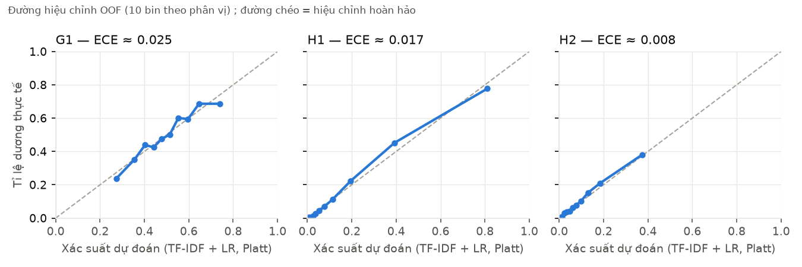
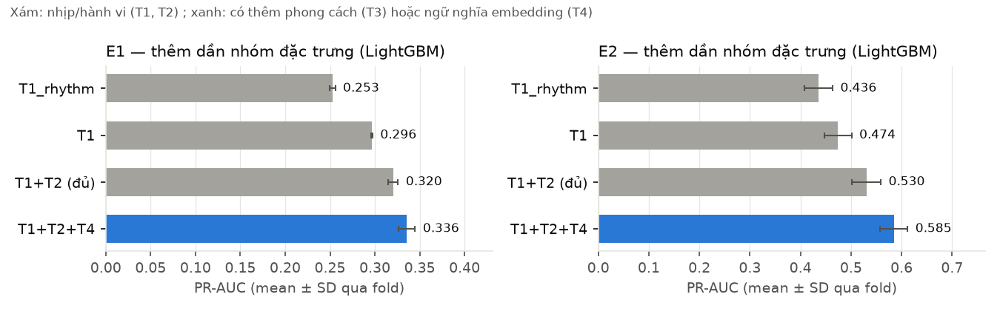
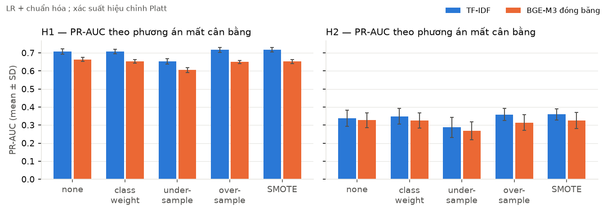
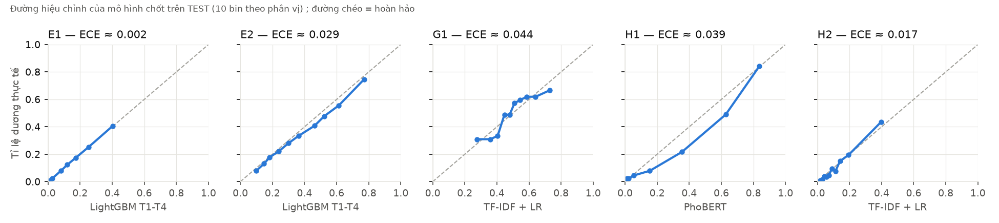
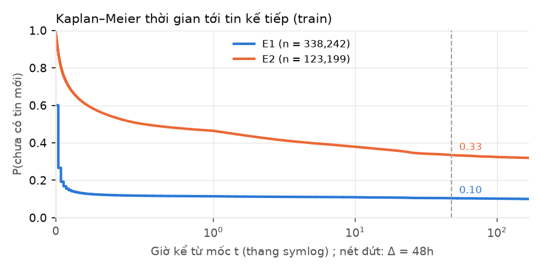
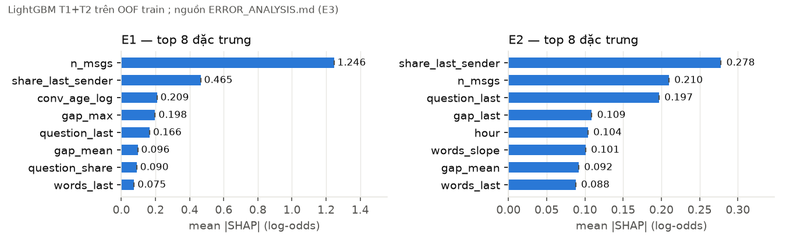
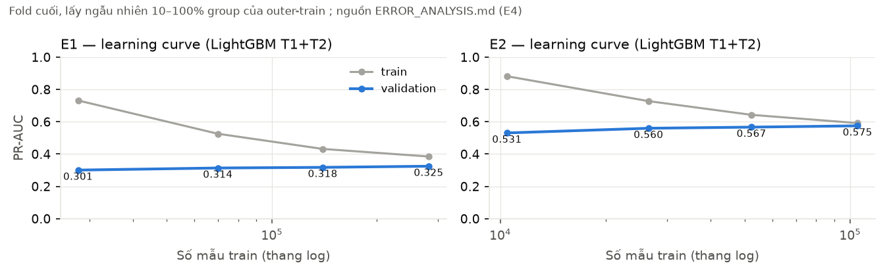

# Báo cáo Module 3 — Conversation Intelligence (BẢN NHÁP A10)

> **Trạng thái 23/11/2026:** R1–R3, R5–R9 là CV/OOF trên **tập train**. Tập test đã mở (A8, 23/11) ; số test ở **R4** và phần lỗi trên test ở 3.4b, không dùng để chỉnh lại mô hình hay ngưỡng.
> Ô ghi `[CHỜ Bx/Cx]` điền khi việc của B/C xong. Mọi con số dưới đây lấy từ
> `docs/results/*.md` (sinh bằng script, có dòng trong `experiments/ledger.csv`) — sửa số thì chạy lại script, không sửa tay.
> Khung mục theo `01_CHUAN_BAO_CAO_AUDITABLE.md` §4 ; thiết kế đầy đủ ở `06_MODULE_3_HEALTH_MONITOR.md`.
> Phân công viết: A — 3.1–3.5 khung + Head A + tổng hợp ; B — mô tả dữ liệu (B7) ; C — Head B nội dung + T3–T5 (C7).

## Tóm tắt

Hai bài toán dự báo trên hội thoại người–người, chỉ dùng thông tin tới thời điểm hiện tại:

- **Head A — hội thoại sắp "tắt"**: P(không ai nhắn tiếp trong Δ = 48h). Hai bộ có timestamp: Ubuntu IRC (E1) và Twitter CSKH (E2).
- **Head B — hội thoại sắp thành công kích / tin độc hại**: dự báo trên Conversations Gone Awry (G1, tiếng Anh) và phân loại bình luận độc hại tiếng Việt ViHSD (H1), ViCTSD (H2).

Kết quả chính trên CV của train (mean ± SD qua 5 fold):

| | Baseline mạnh nhất | Mô hình chốt | PR-AUC chốt | Vận hành |
|---|---|---|---|---|
| E1 | `gap_last` 0.147 ± 0.004 | LightGBM T1+T2 (class_weight) ; chốt test: T1–T4, không resampling | **0.318 ± 0.004** | top 10%: precision 0.345, recall 0.343, lift 3.3× |
| E2 | `gap_last` 0.367 ± 0.026 | LightGBM T1+T2 (SMOTE) ; chốt test: như E1 | **0.529 ± 0.029** | top 10%: precision 0.620, recall 0.193, lift 1.9× |
| G1 | độ dài tiền tố 0.553 ± 0.026 | TF-IDF + LR | **0.631 ± 0.031** | FPR 5%: recall 0.100 |
| H1 | TF-IDF + LR 0.708 ± 0.013 | PhoBERT C2 | **0.770 ± 0.018** | validation: recall 0.663, FPR 0.053 tại τ_B chọn trên calibration |
| H2 | lexicon 0.111 ± 0.001 / độ dài 0.110 ± 0.022 (ngang majority 0.110) | TF-IDF + LR | **0.349 ± 0.044** | FPR 5%: recall 0.297 |

Các phát hiện chính:

- Nhịp trả lời (T1_rhythm) là nhóm đặc trưng quan trọng nhất.
- Xử lý mất cân bằng gần như không đổi PR-AUC, nhưng làm hỏng calibration nếu không hiệu chỉnh lại.
- Mô hình **không chuyển được** giữa hai nền tảng (E1 → E2: ROC-AUC 0.50).
- Phần lớn ca báo đúng chỉ được báo ở tin cuối, tức lead time ngắn.
- Head B tiếng Việt hay "buộc tội oan" câu có từ tục (FPR test 0.333 so với 0.076). Đọc tay 100 FP (phân loại sơ bộ, 3.4b): 26 ca chửi cảm thán / thân mật, 16 ca nhãn có thể sai, 22 ca lỗi rõ của mô hình. Giả thuyết là một phần do định nghĩa nhãn ViHSD, phần còn lại do mô hình túi từ không biết từ tục nhắm vào ai ; chưa phải kết luận nhân quả cho từng lỗi.

Các dòng Head A ở bảng tóm tắt dùng T1+T2 để đối chiếu nền; phần thêm T3/T4 ở R2.
Điểm vận hành TF-IDF của G1/H2 là ngưỡng toàn cục trên OOF train; điểm PhoBERT H1
là mean validation qua 5 fold, mỗi fold có ngưỡng calibration riêng. Không trộn hai cách tổng hợp này.

**Tiêu chí chọn mô hình chốt** (chốt trước A8, cấu hình đóng băng ở `5df9dc1`): (1) hơn baseline với bằng chứng paired ;
(2) nếu ứng viên phức tạp hơn **không** có CI paired ngoài 0 thì giữ mô hình đơn giản hơn — chạy CPU, rẻ, ngưỡng chọn trên chính mô hình đó ;
(3) có artifact fit toàn train sẵn cho `run_test`. Theo đó:
- *E1/E2:* LightGBM T1–T4, không resampling + isotonic. Resampling không đổi PR-AUC nhưng làm hỏng calibration (R3) ; T3/T4 tăng PR-AUC ở R2, được xác nhận paired trên test (R4).
- *G1:* TF-IDF + LR thay vì CRAFT-like GRU — GRU − TF-IDF +0.022, CI paired [−0.0003, +0.0436] chứa 0 ; GRU còn dùng chung calibration để tinh chỉnh và chọn τ (R8).
- *H1:* PhoBERT C2 — CV +0.062 so với TF-IDF ; test xác nhận paired +0.080 [+0.056, +0.102].
- *H2:* TF-IDF + LR. PhoBERT weighted B10 (0.509 ± 0.074) dùng fold khác (lệch phiên bản scikit-learn) nên không so paired được, và không có artifact H2 fit toàn train trước A8 ; trên test chỉ so được PhoBERT zero-shot từ H1 (Δ +0.047, CI chứa 0). Đây là quyết định thận trọng, không phải bằng chứng TF-IDF tốt hơn PhoBERT trên H2.

**Trên test (R4, mở một lần):** E1 0.337 [0.333, 0.341], E2 0.593 [0.581, 0.604] (LightGBM T1–T4) ; G1 0.616 [0.585, 0.653], H1 PhoBERT 0.787 [0.763, 0.810], H2 0.401 [0.268, 0.528]. Test khớp CV ; mọi mô hình chốt hơn baseline với CI paired ngoài 0.

---

## 3.1 Objective and data

**Deployment target.**
- *Head A:* trong app FwP, tại mỗi tin nhắn (và mỗi giờ với hội thoại đang im), ước lượng xác suất đã hiệu chỉnh p = P(không có tin mới trong 48h | lịch sử tới t). App hiện 3 mức: khỏe (p < τ1), hời hợt (τ1 ≤ p < τ2), nguy cơ (p ≥ τ2). Ở mức nguy cơ, app gợi ý riêng tư cho người dùng.
- *Head B:* với G1, dự báo hội thoại có công kích ở phần tiếp theo từ tiền tố trước lượt công kích; với H1/H2, phân loại mức độc hại của một bình luận. App dùng điểm độc hại của tin đang soạn để **nhắc nhẹ người gửi**, không tự động phạt. Hai loại nhãn không đồng nhất và không có bằng chứng trực tiếp trên chat riêng của app.

**Dữ liệu và phạm vi suy luận.** Nhóm dùng năm bộ dữ liệu bên ngoài, không thu
chat người dùng FwP. E1/E2 là hội thoại hỗ trợ bằng tiếng Anh; G1 là thảo luận
Wikipedia tiếng Anh; H1/H2 là bình luận công khai tiếng Việt, mỗi mẫu chỉ gồm
một bình luận. Vì vậy các bộ này là dữ liệu thay thế để kiểm chứng phương pháp,
không phải mẫu đại diện cho chat riêng của sinh viên. Head A đo khoảng im lặng,
không trực tiếp đo mức quan tâm hay chất lượng quan hệ; hội thoại kết thúc sau
khi được hỗ trợ cũng có thể mang nhãn dương. Chi tiết nguồn, tiền xử lý và
checksum tham chiếu ở `docs/data_cards/` và `data/checksums.txt`.

| ID | Dataset | Nguồn / license | Train: N mẫu / N đơn vị độc lập | Test: N mẫu / N đơn vị | Prevalence train / test | Đơn vị độc lập |
|---|---|---|---|---|---|---|
| E1 | Ubuntu Dialogue Corpus (IRC, 2 người) | Kaggle `rtatman/ubuntu-dialogue-corpus` ; "other", nghiên cứu | 2,029,147 / 360,218 hội thoại | 497,882 / 90,054 | 0.104 / 0.102 | hội thoại |
| E2 | Customer Support on Twitter | Kaggle `thoughtvector/customer-support-on-twitter` ; CC BY-NC-SA 4.0 | 125,794 / 56,318 khách hàng | 26,803 / 14,079 | 0.334 / 0.332 | khách hàng |
| G1 | Conversations Gone Awry — Wikipedia | ConvoKit ; CC BY-SA | 3,348 / 1,446 trang | 840 / 370 | 0.500 / 0.500 (ghép cặp) | trang (giữ cặp) |
| H1 | ViHSD | bản sao HF `htdung167/ViHSD` của `uitnlp/vihsd` ; MIT theo bản gốc | 26,719 / 24,452 nhóm nội dung | 6,681 / 6,116 | 0.173 / 0.173 | nội dung trùng |
| H2 | UIT-ViCTSD | HF `tarudesu/ViCTSD` ; nghiên cứu | 8,001 / 660 bài báo | 1,999 / 165 | 0.110 / 0.110 | bài báo |

Số trong bảng là số **mẫu sau tạo nhãn và chia tập**, không phải tổng số tin
hay hội thoại thô trong Data Card. E1/E2 có thể có nhiều mốc trong một hội thoại;
N đơn vị ở E2 là khách hàng, không phải số hội thoại. Prevalence là tỉ lệ nhãn
dương trong các mẫu có nhãn xác định; N mẫu Head A trong `configs/test_lock.json`
còn gồm các mốc bị censor và bị loại khi chạy phân loại nhị phân. Số train/test
và prevalence trong bảng lấy từ file metadata khóa, không mở dữ liệu test; các
prevalence fit/calibration/validation theo từng fold chưa được tổng hợp trong
bản báo cáo này, không dùng tỉ lệ toàn train như thể là số của từng fold.

H1 gộp OFFENSIVE (1) và HATE (2) thành độc hại; H2 dùng cột `Toxicity`, không dùng
`Constructiveness` thay cho nhãn độc hại. G1 có prevalence 50% do ghép cặp theo thiết kế,
không đại diện tần suất công kích trong app. Nhãn công kích tương lai của G1 và
nhãn độc hại tại bình luận của H1/H2 khác nhau, nên không gộp chúng thành cùng
một mục tiêu hay so trực tiếp điểm như thể cùng phân phối.

Về quyền sử dụng: E1 được Kaggle ghi “other”, không đủ để xác nhận quyền tái phân
phối; E2 là CC BY-NC-SA 4.0, có hạn chế phi thương mại. Với G1, CC BY-SA áp dụng
cho nội dung Wikipedia, còn quyền đối với nhãn corpus cần được xác nhận riêng;
H1 ghi MIT theo nguồn gốc nhưng bản đang dùng là bản sao. H2 chưa có license xác
nhận tại nguồn HF. Các mô tả “nghiên cứu” trong Data Card không thay thế giấy
phép; cần xác minh điều khoản nguồn và bản sao trước khi phát hành hoặc sử dụng
ngoài phạm vi được phép.

- **Mẫu Head A:** mẫu là cặp (hội thoại, mốc t) tại tin thứ 6, 8, 10… Đặc trưng chỉ lấy từ tin ≤ t. Nhãn y = 1 nếu không có tin nào trong (t, t + 48h]. Mốc bị right-censor ở 48h bị loại khỏi bài nhị phân (E1: 97, E2: 1,736) nhưng vẫn giữ cho survival.
- **Mẫu Head B:** G1 có một mẫu mỗi hội thoại; hội thoại hỏng chỉ dùng tiền tố
  trước lượt công kích đầu tiên, hội thoại lành bỏ lượt cuối; nếu tiền tố rỗng
  thì bỏ cả cặp (`src/m3_health/labels.py`). H1/H2 mỗi bình luận là một mẫu và
  dùng nhãn của bộ dữ liệu, không có lịch sử hội thoại để đánh giá dự báo sớm.
- **Tạo và chia dữ liệu:** E1 giữ hội thoại đúng hai người; E2 dựng cây trả lời,
  giữ hội thoại một khách hàng và một tài khoản CSKH. H1 gộp split nguồn rồi
  nhóm văn bản chuẩn hóa trùng nhau; H2 gộp split nguồn rồi nhóm theo tiêu đề
  bài báo. G1 dùng split test chính thức, gộp train và validation nguồn vào train.
  Chi tiết và giới hạn cách nhóm nằm trong từng Data Card; dữ liệu thô không commit.
- **Vì sao chọn đơn vị độc lập như trên:**
  - Các mốc trong cùng hội thoại tự tương quan với nhau.
  - E2 có cùng một khách hàng ở nhiều hội thoại.
  - Ở G1, mỗi hội thoại "hỏng" được ghép với một hội thoại "lành" cùng trang.
  - Split gốc của H1/H2 bị rò rỉ: 802/6,680 bình luận test ViHSD trùng nội dung với train ; 974/1,000 bình luận test ViCTSD cùng bài báo với train. Vì vậy nhóm tự chia lại theo group.
- **Giới hạn tài nguyên:** CV Head A dùng 60,000 hội thoại lấy ngẫu nhiên (seed 42) từ train của mỗi bộ (`labels.cv_conversations`). Kết quả: E1 338,240 mẫu, E2 123,102 mẫu.

## 3.2 Evaluation design

| Phần | Head A (E1, E2) | Head B (G1) | Head B (H1, H2) |
|---|---|---|---|
| Test (khóa) | 20% group **bắt đầu muộn nhất** (E1: hội thoại; E2: khách hàng) | split chuẩn ConvoKit (cặp ghép cùng phía) | 20% theo group |
| Outer CV | forward chaining K = 5 theo thời điểm bắt đầu group | group K-fold K = 5 (group = trang) | group K-fold K = 5 |
| Calibration | 20% group muộn nhất của mỗi outer-train (mô hình fit trên 80% còn lại) | 20% group của outer-train | như G1 |
| Seeds | 42 cho split test và mô hình ; R = 1 với LightGBM/LR. R = 3 (seed 42/43/44) cho PhoBERT B10 | 42 | 42 |
| Bootstrap | cluster theo hội thoại, B = 2000, percentile CI 95% ; so sánh mô hình bằng paired bootstrap | cluster theo trang | cluster theo group |

- **Chống rò rỉ:**
  - `assert_no_group_leak` và `assert_time_order` chạy ở mọi fold (`src/eval/splits.py`, test trong `tests/test_splits_no_leak.py`).
  - Scaler, TF-IDF, SMOTE và mô hình chỉ fit trên phần fit của outer-train; calibrator fit trên phần calibration tách theo group, không trên outer-validation. PCA là biến đổi đóng băng fit từ DailyDialog train độc lập (C1), không fit lại trên các bộ đích.
  - Ngưỡng từng fold chọn trên calibration; ngưỡng OOF toàn cục được báo riêng khi script có tính. Test chỉ dùng để báo cáo.
- **Khóa test:** băm danh sách group test nằm ở `configs/test_lock.json`. `load_train()` không bao giờ trả về test. Chỉ A mở test, ngày 20/11.

## 3.3 Learning procedure

```
messages → mẫu (c, t) + nhãn + cờ censor → đặc trưng T1+T2 (≤ t)
→ StandardScaler (LR) → [resampler: chỉ phần fit] → mô hình
→ prior shift về prevalence thật → calibrator (Platt / isotonic trên calibration) → τ
```

- **Đặc trưng:** 21 đặc trưng (`src/m3_health/features.py`):
  - T1_rhythm (9): số tin, tuổi hội thoại, các thống kê khoảng cách tin, burstiness.
  - T1_clock (3): giờ trong ngày, cuối tuần, ban đêm.
  - T1_asym (2): tỉ lệ người gửi tin cuối, double-text.
  - T2_surface (7): độ dài, tin cụt, câu hỏi.
  - T3 (B5, 10 cột): LSM = trung bình `1 − |pA−pB|/(pA+pB+0.0001)` trên các nhóm từ chức năng có xuất hiện; mirroring = Jaccard token giữa hai tin kề khác sender; độ dài lượt và tỉ lệ đổi lượt. Cửa sổ 10 tin kết thúc tại t; chỉ đọc `turn_idx ≤ t`. LSM cần đúng hai sender; giá trị thiếu là NaN + cờ thiếu. Lexicon nhỏ tự xây, không tương đương LIWC; bản Việt tách âm tiết và chưa được đánh giá (`B5_T3_FEATURES.md`).
  - T4 (C1/B8, 42 cột): BGE-M3 đa ngữ đóng băng, 10 thống kê/cờ về reply cosine, topic drift/novelty và 32 tọa độ PCA. Encoder 1.024 chiều, chuẩn hóa L2, max length 256, revision pin trong `configs/embedding.yaml`. PCA fit duy nhất trên 87.171 lượt DailyDialog train (giữ 0.420795 explained variance), không fit trên E1/E2/G1/H1/H2. T3/T4 được thêm vào Head A theo cùng fold trong R2; cache tin tương lai không được lấy vào tiền tố.
  - T5 (C4): chuỗi embedding BGE-M3 → PCA-32 → GRU một chiều → dropout → linear, dùng hidden cuối cho G1. Đối chứng `table_lr` ghép đặc trưng số T2 với mean + last PCA-32 rồi StandardScaler + LR. Đây là CRAFT-like với encoder đóng băng, không phải tái lập nguyên bản CRAFT. T5 Head A không chạy, nên không được ghi như một tầng đã kiểm chứng trên E1/E2.
- **Candidate Head A:** đa số ; rule của tài liệu gốc ; chỉ `gap_last` ; LR ; LightGBM (300 cây, lr 0.05, 31 lá). Mỗi mô hình × 5 phương án mất cân bằng (none, class_weight, undersample, oversample, SMOTE). Survival: Cox PH, Random Survival Forest. TabPFN v2 (X7, B9): so với LightGBM trên cùng tập con 100/300/1.000 group của từng outer-train (TabPFN v2 giới hạn 10.000 dòng).
- **Candidate Head B:** đa số ; từ điển từ xúc phạm ; LR chỉ độ dài ; TF-IDF + LR (có và không có đặc trưng độ dài). PhoBERT `vinai/phobert-base-v2` fine-tune trên H1 (C2: tách từ underthesea, weighted BCE, 2 epoch, max_len 128, Platt). CRAFT-like trên G1 (C4: chuỗi embedding BGE-M3 → PCA-32 → GRU) so với LR trên mean + last PCA-32 (`table_lr`).
- **Cấu hình C4:** `configs/c4_craft.yaml`, seed 42, hidden ∈ {32, 64}, dropout ∈ {0.1, 0.3}, tối đa 20 epoch, patience 3 theo Macro-F1 calibration, batch 64, AdamW lr 0.001, weight decay 0.0001, clip gradient 1.0. Split/khởi tạo dùng seed suy ra trong runner; K = 5, một lượt CV. Calibration đồng thời chọn cấu hình/early stopping/Platt/τ_B là giới hạn thiết kế, không phải nested CV độc lập hoàn toàn.
- **C5 / X14:** BGE-M3 đa ngữ đóng băng mã hóa H1 và tiền tố G1. Bộ phân loại độc hại H1 trên embedding sinh một điểm cho mỗi tiền tố G1; điểm đó được thêm vào TF-IDF + LR G1. So sánh theo cùng group fold và paired cluster bootstrap. X14 không dùng PhoBERT đơn ngữ để mã hóa tiếng Anh.
- **Calibration:** Head A dùng isotonic; Head B dùng Platt trên phần calibration tách theo group. Prior shift đưa xác suất về prevalence thật trước khi hiệu chỉnh khi resampling làm lệch xác suất.
- **Ngưỡng:**
  - *Head A τ2:* **ngân sách cảnh báo** top 10% điểm. Lý do: tỉ lệ chi phí 1 : 2 cho recall 0.4% trên E1 (gần như không bao giờ báo), và cùng một tỉ lệ chi phí lại cho tỉ lệ cảnh báo rất khác giữa E1 và E2 (`HEAD_A_COST.md`). Ngân sách cố định giữ số lần làm phiền mỗi người dùng ổn định khi prevalence thay đổi.
  - *Head A τ1:* recall ≥ 0.8, với τ1 ≤ τ2.
  - *Head B τ_B:* chọn để FPR ≤ 5% trên calibration vì báo nhầm làm phiền người gửi. Đây là mục tiêu trên mẫu chọn ngưỡng; không bảo đảm FPR ≤ 5% trên validation, test hoặc chat tiếng Việt trong app. Fallback luật không có bảo đảm calibration này.

## 3.4 Results

### R1 — CV mean ± SD (train)

Bảng đủ mọi candidate ở `docs/results/HEAD_A_CV.md`, `HEAD_B_CV.md`. Rút gọn:

| Bộ | Mô hình | PR-AUC | ROC-AUC | Brier (isotonic) | ECE isotonic |
|---|---|---|---|---|---|
| E1 | rule (tài liệu gốc) | 0.105 ± 0.002 | 0.515 ± 0.004 | 0.092 ± 0.001 | 0.003 ± 0.003 |
| E1 | gap_last | 0.147 ± 0.004 | 0.583 ± 0.005 | 0.091 ± 0.001 | 0.003 ± 0.002 |
| E1 | LR | 0.197 ± 0.007 | 0.692 ± 0.009 | 0.088 ± 0.001 | 0.004 ± 0.001 |
| E1 | **LightGBM + class_weight** | **0.318 ± 0.004** | **0.827 ± 0.003** | 0.079 ± 0.002 | 0.004 ± 0.001 |
| E2 | rule | 0.351 ± 0.026 | 0.515 ± 0.005 | 0.224 ± 0.008 | 0.018 ± 0.011 |
| E2 | gap_last | 0.367 ± 0.026 | 0.557 ± 0.002 | 0.222 ± 0.008 | 0.015 ± 0.006 |
| E2 | LR | 0.484 ± 0.025 | 0.659 ± 0.005 | 0.209 ± 0.007 | 0.019 ± 0.006 |
| E2 | **LightGBM + SMOTE** | **0.529 ± 0.029** | **0.699 ± 0.005** | 0.200 ± 0.006 | 0.016 ± 0.004 |

| Bộ | Mô hình | PR-AUC | ROC-AUC | Precision / Recall / FPR @τ_B | CI 95% PR-AUC (cluster bootstrap OOF) |
|---|---|---|---|---|---|
| G1 | length_lr | 0.553 ± 0.026 | 0.572 ± 0.018 | 0.545 / 0.048 / 0.040 | — |
| G1 | **TF-IDF + LR** | **0.631 ± 0.031** | 0.654 ± 0.017 | 0.672 / 0.117 / 0.057 | [0.607, 0.647] |
| G1 | TF-IDF + LR, bỏ độ dài | 0.626 ± 0.023 | 0.651 ± 0.019 | 0.649 / 0.097 / 0.051 | — |
| H1 | lexicon | 0.238 ± 0.013 | 0.564 ± 0.009 | 0.608 / 0.148 / 0.020 | — |
| H1 | **TF-IDF + LR** | **0.708 ± 0.013** | 0.904 ± 0.004 | 0.715 / 0.576 / 0.048 | [0.691, 0.720] |
| H2 | **TF-IDF + LR** | **0.349 ± 0.044** | 0.779 ± 0.034 | 0.419 / 0.303 / 0.053 | [0.263, 0.421] |
| G1 | CRAFT-like GRU | 0.653 ± 0.035 | 0.671 ± 0.022 | 0.717 / 0.144 / 0.055 | [0.6289, 0.6681] |
| H1 | PhoBERT C2 | 0.770 ± 0.018 | 0.928 ± 0.009 | 0.725 / 0.663 / 0.053 | chưa có CI bootstrap trong artifact C2 |

- CV mean ± SD mô tả biến thiên giữa fold, không phải CI hay kiểm định thắng baseline. CRAFT và X14 có paired bootstrap ở R8; PhoBERT H1 cao hơn TF-IDF về điểm CV nhưng chưa có paired CI trong artifact C2. Trên test (R4), paired bootstrap mọi mô hình chốt so với baseline đều có CI ngoài 0 ; PhoBERT − TF-IDF H1 +0.080 [+0.056, +0.102].
- G1: bỏ đặc trưng độ dài gần như không đổi PR-AUC (0.631 → 0.626). Như vậy mô hình học nội dung, không chỉ học "tiền tố hỏng dài hơn 0.5 lượt".




Platt làm giảm sai số hiệu chỉnh trong miền được đánh giá: TF-IDF có ECE validation
0.048 ± 0.013 (G1), 0.019 ± 0.003 (H1), 0.017 ± 0.002 (H2), theo `HEAD_B_CV.md`.
PhoBERT H1 đạt 0.016 ± 0.006 (R9). ECE gộp nhỏ không chứng minh xác suất đúng
cho từng người hay chat riêng tiếng Việt; app chỉ dùng lời nhắc, không hiển thị điểm như “% rủi ro thực tế”.

### R2 — Ablation (X1, LightGBM + none ; `HEAD_A_ABLATION.md`)

| Tập đặc trưng | E1 PR-AUC | E2 PR-AUC |
|---|---|---|
| T1_rhythm | 0.253 ± 0.003 | 0.436 ± 0.028 |
| T1 | 0.296 ± 0.001 | 0.474 ± 0.027 |
| T1 + T2 | 0.320 ± 0.005 | 0.530 ± 0.029 |
| bỏ T1_rhythm | 0.181 ± 0.016 (Δ −0.140) | 0.476 ± 0.030 (Δ −0.054) |
| bỏ T1_clock | 0.322 ± 0.005 (Δ +0.001) | 0.529 ± 0.029 (Δ −0.001) |
| bỏ T1_asym | 0.280 ± 0.005 (Δ −0.041) | 0.490 ± 0.028 (Δ −0.040) |
| + T3 (phong cách: LSM, mirroring, turn-taking ; B5) | 0.327 ± 0.006 (Δ +0.007 ± 0.003) | 0.566 ± 0.030 (Δ +0.035 ± 0.004) |
| + T4 không T3 (BGE-M3 đóng băng: độ liên quan trả lời, topic drift / novelty, PCA 32 chiều) | 0.336 ± 0.009 (Δ +0.015 ± 0.004) | 0.585 ± 0.027 (Δ +0.054 ± 0.005) |
| + T3 + T4 | **0.337 ± 0.010** (Δ +0.017 ± 0.005) | **0.606 ± 0.026** (Δ +0.076 ± 0.004) |
| + T5 (bộ mã hóa chuỗi) | không làm cho Head A — trên G1, GRU đọc chuỗi không hơn LR trên mean/last embedding (R8), nên không mở rộng sang E1/E2 | |



**RQ1 (tạm):** nhịp trả lời có ảnh hưởng lớn nhất trong ablation, sau đó là bất đối xứng hai bên và bề mặt văn bản; giờ trong ngày ít giúp trên hai bộ. T3/T4 tăng điểm CV nhiều hơn trên E2 so với E1. Đây là kết quả theo fold, chưa có paired cluster CI cho mức tăng T3/T4. Giả thuyết CSKH kết thúc sau khi giải quyết vấn đề phù hợp với miền dữ liệu nhưng chưa được kiểm chứng nhân quả. Dòng T4 không T3 lấy từ báo cáo lịch sử tại commit `49af78b`; bảng ablation hiện tại đã thay bằng tập tích lũy T3+T4 tại `d605bf5`.

### R3 — Mất cân bằng (X2)

- **Head A** (`HEAD_A_CV.md`): 5 phương án cho PR-AUC chênh nhau ≤ 0.015, nằm trong khoảng 1 SD. Riêng undersample kém hơn một chút. SMOTE làm ECE thô tăng từ 0.006 lên 0.084 (E1) và từ 0.021 lên 0.128 (E2). Sau prior shift và isotonic thì ECE về khoảng 0.004 / 0.016. **Kết luận:** với LightGBM trên 10–33% dương, resampling không cải thiện xếp hạng. Bắt buộc phải hiệu chỉnh lại xác suất nếu dùng resampling.
- **Head B** (`IMBALANCE_B.md`, H2 prevalence 0.11):
  - Ở ngưỡng mặc định 0.5, "none" cho recall 0.009, tức gần như không bao giờ báo. class_weight / oversample / SMOTE nâng recall lên khoảng 0.40 nhưng FPR thành 8–10%.
  - Sau calibration và τ_B (FPR 5%), mọi phương án hội tụ về recall khoảng 0.30, trừ undersample còn 0.21.
  - Lặp lại với **embedding BGE-M3 đóng băng + LR** (SMOTE trên vector câu): cùng kết luận ; undersample vẫn kém nhất. Embedding đóng băng **kém hơn TF-IDF** ở H1 (PR-AUC 0.664 ± 0.011 so với 0.707 ± 0.015) và không hơn ở H2 (0.327 ± 0.041 so với 0.339 ± 0.045): độc hại phụ thuộc mạnh vào từ ngữ cụ thể, vector câu tổng quát làm mờ tín hiệu này → cần fine-tune (PhoBERT, C2/B10 bên dưới).
  - **PhoBERT fine-tune trên H2** (B10, `B10_PHOBERT_H2.md`, tách từ underthesea, 5 fold × 3 seed): PR-AUC weighted BCE **0.509 ± 0.074**, none 0.482 ± 0.095, oversampling 0.471 ± 0.077. Paired theo fold (trung bình 3 seed): weighted − none +0.027, cao hơn ở 3/5 fold ; oversampling − weighted −0.038, thấp hơn ở cả 5/5 fold. Lặp mẫu không giúp mà còn tốn gấp ~1.7 thời gian fit.
  - **Kết luận:** lợi ích "thấy được" của resampling chủ yếu là dịch ngưỡng. Chọn ngưỡng đúng cách cho kết quả tương đương. Với mạng nơ-ron cũng vậy: đổi trọng số loss có xu hướng nhỉnh hơn (chưa chắc chắn), lặp mẫu thì kém hơn. Head B dùng weighted BCE cho PhoBERT, class_weight cho LR, và τ_B theo FPR.



### R4 — Test (chạm 1 lần, A8 ngày 23/11)

Nguồn: `TEST_RESULTS_E1.md`, `TEST_RESULTS_E2.md`, `TEST_RESULTS_G1_H1_H2.md` (commit code `5df9dc1`, ledger module `m3_test`).
Mô hình fit trên toàn bộ train, τ chọn trên train (OOF / calibration), không chọn lại trên test.
CI 95% cluster bootstrap theo group (B = 2000) ; Δ = PR-AUC(chốt) − PR-AUC(đối chứng), paired trên cùng lần lấy mẫu.

| Bộ | Mô hình chốt | n test (prevalence) | PR-AUC [CI 95%] | ROC-AUC | Brier / ECE | Precision / Recall / FPR @τ | Δ so với đối chứng [CI 95%] |
|---|---|---|---|---|---|---|---|
| E1 | LightGBM T1–T4, không resampling, isotonic ; τ1 = 0.134, τ2 = 0.284 | 497,796 (0.102) | **0.337** [0.333, 0.341] | 0.843 | 0.077 / 0.002 | 0.364 / 0.379 / 0.075 | `gap_last` +0.194 [+0.190, +0.197] ; LightGBM T1+T2 +0.020 [+0.018, +0.022] |
| E2 | như E1 ; τ1 = 0.249, τ2 = 0.640 | 25,259 (0.332) | **0.593** [0.581, 0.604] | 0.745 | 0.185 / 0.029 | 0.738 / 0.225 / 0.040 | `gap_last` +0.238 [+0.226, +0.249] ; LightGBM T1+T2 +0.075 [+0.067, +0.082] |
| G1 | TF-IDF + LR, Platt ; τ_B = 0.689 | 840 (0.500) | **0.616** [0.585, 0.653] | 0.645 | 0.235 / 0.044 | 0.662 / 0.102 / 0.052 | lexicon +0.116 [+0.085, +0.153] |
| H1 | PhoBERT C2 fit toàn H1 train, Platt/τ_B chuyển từ model 80% ; τ_B = 0.489 | 6,681 (0.173) | **0.787** [0.763, 0.810] | 0.933 | 0.075 / 0.039 | 0.664 / 0.769 / **0.081** | TF-IDF + LR +0.080 [+0.056, +0.102] ; lexicon +0.554 [+0.527, +0.579] |
| H2 | TF-IDF + LR, Platt ; τ_B = 0.253 | 1,999 (0.110) | **0.401** [0.268, 0.528] | 0.802 | 0.081 / 0.016 | 0.457 / 0.384 / 0.056 | lexicon +0.291 [+0.181, +0.399] ; PhoBERT C2 zero-shot (X12) +0.047 [−0.022, +0.117] |

- **Test khớp CV:** E1 0.337 (CV T1–T4 0.337 ± 0.010), E2 0.593 (0.606 ± 0.026), G1 0.616 (0.631 ± 0.031), H1 PhoBERT 0.787 (0.770 ± 0.018), H2 0.401 (0.349 ± 0.044, CI test rộng vì chỉ 1,999 bình luận). Không có dấu hiệu chọn mô hình quá khớp với CV.
- **Mọi mô hình chốt hơn baseline mạnh nhất, CI paired nằm ngoài 0.** T3+T4 có lợi trên test ở cả hai bộ (E1 +0.020, E2 +0.075), lần đầu có CI paired cho mức tăng này (R2 chỉ có SD theo fold).
- **PhoBERT hơn TF-IDF trên H1: +0.080 [+0.056, +0.102]** — paired trên cùng tập test, nên trả lời được câu hỏi R9 để ngỏ (CV hai bên khác fold do lệch phiên bản scikit-learn).
- **X12 trên test:** PhoBERT học trên H1 kém TF-IDF học trực tiếp trên H2 0.047, CI chứa 0: chưa đủ bằng chứng hơn/kém. Giữ TF-IDF làm mô hình chốt H2.
- **FPR H1 = 0.081 > mục tiêu 5%.** Platt/τ_B chọn trên model fit 80% rồi áp cho model refit 100% (`C2_FINAL_PHOBERT.md`) ; model refit cho điểm cao hơn nên vượt ngưỡng nhiều hơn. Với TF-IDF (τ chọn trên chính model đó) FPR test 0.052–0.056. Hệ quả và cách xử lý ở 3.5.
- Lần mở đầu (19:13, toàn bộ 5 bộ) bị hệ điều hành dừng vì thiếu RAM khi đang tính T4 cho E1, trước khi tính chỉ số nào ; chạy lại bằng `--again` theo từng nhóm bộ. `experiments/test_opened.json` ghi đủ 4 lần.
- ROC-AUC chưa có CI. ECE (10 bin phân vị) lấy từ output console của `run_test`, `TEST_RESULTS_*.md` không in cột này. ECE PhoBERT H1 tăng từ 0.016 (CV) lên 0.039 trên test, cùng nguyên nhân với FPR: Platt chuyển từ model 80%.



Hình trên: E1, E2, H2 bám đường chéo ; H1 (PhoBERT) nằm dưới đường chéo ở vùng điểm giữa — điểm cao hơn tỉ lệ thật, khớp với FPR 0.081 vượt mục tiêu ; G1 dồn điểm vào khoảng 0.3–0.7 (mô hình yếu, ROC 0.645).

### R5 — Cross-domain Head A (X4, RQ2)

| Train → Test | PR-AUC | ROC-AUC | Brier thô → sau prior shift |
|---|---|---|---|
| E2 → E2 (in-domain) | 0.530 ± 0.029 | 0.701 ± 0.005 | 0.200 |
| E1 → E2 | 0.331 ± 0.025 | **0.501 ± 0.005** | 0.302 → 0.285 |
| E1 → E1 (in-domain) | 0.320 ± 0.005 | 0.829 ± 0.003 | 0.079 |
| E2 → E1 | 0.132 ± 0.003 | 0.602 ± 0.003 | 0.106 → 0.094 |

**RQ2 (Head A):** E1 → E2 chỉ ngang ngẫu nhiên. Giả thuyết (chưa kiểm chứng nhân quả): ý nghĩa của "tắt" khác nhau giữa hai nền tảng — IRC tắt khi bỏ đi, CSKH tắt khi đã giải quyết xong ; ví dụ 1–7 ở 3.4b khớp với giả thuyết này. Prior shift chỉ sửa được calibration, không sửa được xếp hạng. Khi chuyển miền phải học lại trên dữ liệu của miền đích.

### R6 — Survival vs nhị phân (X3, `HEAD_A_SURVIVAL.md`)

| Bộ | Mô hình | C-index | IBS | PR-AUC 48h |
|---|---|---|---|---|
| E1 | Cox PH | 0.602 ± 0.004 | 0.032 ± 0.001 | 0.180 ± 0.008 |
| E1 | RSF | 0.616 ± 0.005 | 0.019 ± 0.002 | 0.281 ± 0.010 |
| E1 | LightGBM (riêng cho 48h) | — | — | 0.320 ± 0.005 |
| E2 | Cox PH | 0.607 ± 0.003 | 0.118 ± 0.007 | 0.459 ± 0.024 |
| E2 | RSF | 0.631 ± 0.004 | 0.121 ± 0.008 | 0.520 ± 0.025 |
| E2 | LightGBM (riêng cho 48h) | — | — | 0.530 ± 0.029 |

RSF là **một** mô hình trả lời mọi Δ (1h, 24h, 48h, 72h), giữ được các mẫu bị censor và chỉ kém LightGBM huấn luyện riêng cho từng Δ khoảng 0.01–0.04 PR-AUC. Trong app, nên dùng LightGBM cho cảnh báo 48h và RSF cho câu hỏi "còn bao lâu".



Đường Kaplan–Meier (train, không có đặc trưng): E1 rơi gần hết trong vài phút đầu rồi phẳng ở khoảng 0.10 — trên IRC tin kế tiếp hoặc đến ngay, hoặc không đến ; E2 giảm dần trong nhiều giờ, còn 0.33 ở 48h. Giá trị tại 48h khớp prevalence nhãn nhị phân (0.10 / 0.33).

**Conformal (X8, `HEAD_A_CONFORMAL.md`):**
- CQR một phía đạt coverage khoảng 0.90 đúng mục tiêu trong miền.
- Cận dưới L ≈ 0 nên không dùng được.
- Cận trên U trên E1 có trung vị 1.08h (dùng được: "90% sẽ có tin trong khoảng 1h"). Trên E2, U chạm trần 7 ngày.
- Khi chuyển miền, coverage sụp: U còn 0.56 (E1 → E2), L còn 0.59 (E2 → E1). Weighted conformal (Tibshirani 2019) khôi phục được coverage nhưng làm khoảng thành vô dụng (ESS khoảng 150–300). Calibration lại trên miền đích thì khôi phục khoảng 0.90.

### R7 — Độ nhạy (X5)

- **Chi phí FN : FP** từ 1 : 3 tới 5 : 1 (`HEAD_A_COST.md`): với E1, tỉ lệ cảnh báo đi từ 0% tới 29% → lý do chọn ngân sách cảnh báo.
- **Ngân sách cảnh báo** 5 / 10 / 20%:
  - E1: precision 0.40 / 0.35 / 0.28, recall 0.20 / 0.34 / 0.57.
- **Δ:** E1 prevalence gần như không đổi theo Δ (13.0% ở 10 phút, 10.4% ở 48h) ; E2 thay đổi mạnh (62% → 33%).
- X6 (B6): quy tắc dấu `?` trên DailyDialog validation đạt precision 0,745 và recall 0,983 với act question (8.069 lượt); act không phải nhãn tin cụt, nên chưa đo được precision/recall tin cụt. Bản tiếng Việt chưa được đánh giá; chi tiết và giới hạn trong `docs/results/B6_DAILYDIALOG.md`.

### R8 — Head B dự báo trên G1 (X11)

- Ở τ_B (FPR 5%), TF-IDF + LR chỉ bắt 10% hội thoại hỏng.
- **Horizon** (`HEAD_B_ERRORS.md`): 246/1,674 hội thoại hỏng (14.7%) được cảnh báo ở một tiền tố nào đó. Trong 196 TP tại tiền tố triển khai, lead trung vị 0 lượt (IQR 0–2) ; 48% được báo trước ≥ 1 lượt.
- **CRAFT-like GRU** (C4, `HEAD_B_CRAFT.md`): PR-AUC 0.653 ± 0.035 so với TF-IDF + LR 0.630 ± 0.031 và `table_lr` (T2 + mean/last PCA-32) 0.643 ± 0.026. Paired cluster bootstrap trên OOF, B = 2000, group = trang: GRU − TF-IDF +0.0217, CI 95% [−0.0003, +0.0436], p = 0.0540; GRU − table_lr +0.0041 [−0.0137, +0.0215], p = 0.6480. Cả hai CI chứa 0: chưa có bằng chứng mô hình chuỗi hơn đối chứng; cũng chưa chứng minh hai mô hình tương đương. Ở τ_B recall chỉ 0.144. Điểm PR-AUC trên OOF gộp 0.64714 khác mean fold 0.65297; CI [0.6289, 0.6681] thuộc OOF gộp.
- **Giới hạn chọn ngưỡng C4:** cùng phần calibration được dùng để chọn hidden size/dropout, dừng sớm, fit Platt và chọn τ_B, nên ngưỡng có thể hơi lạc quan. FPR trên validation là 0.055, cao hơn mục tiêu 0.05; điều kiện FPR ≤ 5% chỉ được áp trên calibration, không bảo đảm ở dữ liệu mới.
- **X14 (C5, `HEAD_B_X14.md`)**: điểm độc hại học trên H1 bằng BGE-M3 đa ngữ đóng băng + LR thêm vào TF-IDF + LR G1. PR-AUC 0.631 → 0.632; paired cluster bootstrap Δ +0.002, CI 95% [−0.002, +0.006], p = 0.370. Không có bằng chứng điểm độc hại xuyên ngôn ngữ cải thiện dự báo G1. Hai nhiệm vụ có nhãn khác nhau: độc hại của bình luận hiện tại so với nguy cơ công kích trong phần tiếp theo của hội thoại.

### R9 — Phân loại độc hại tiếng Việt (X12)

- Kết quả TF-IDF + LR như ở R1.
- **PhoBERT fine-tune** (C2, `HEAD_B_C2_PHOBERT_X12.md`): H1 PR-AUC **0.770 ± 0.018** so với TF-IDF + LR 0.708 ± 0.013; ROC-AUC 0.928; ở τ_B recall 0.663 so với 0.576, FPR 0.053 so với 0.048. ECE 0.104 → 0.016 sau Platt. Điểm CV tăng 0.062 nhưng chưa có paired CI; chưa kết luận ý nghĩa thống kê từ SD. Embedding BGE-M3 đóng băng + LR thấp hơn TF-IDF trong các cấu hình đã thử; điều này không chứng minh mọi mô hình đều cần fine-tune.
- **X12 zero-shot H1 → H2:** PhoBERT học trên H1 đạt PR-AUC 0.397 trên toàn H2 train, so với TF-IDF học trực tiếp H2 0.349 ± 0.044 CV. Thiết kế không ghép cặp, chưa có CI cho chênh lệch, nên không kết luận hơn hoặc tương đương. Giữ τ_B = 0.5012 từ H1 thì FPR H2 0.015 và recall 0.213: điểm ngưỡng không chuyển nguyên hiệu quả giữa miền; muốn đổi ngưỡng cần calibration có nhãn ở miền đích tách khỏi test. Đây là model X12 lịch sử, khác artifact full-train ngày 17/11 có τ_B ≈ 0.489.
- **B10 trên H2** (`B10_PHOBERT_H2.md`): weighted PR-AUC 0.509 ± 0.074, none 0.482 ± 0.095, oversampling 0.471 ± 0.077 trên 5 fold × 3 seed. Weighted hơn none ở 3/5 fold; oversampling kém weighted trong cả 5 fold. Fold của B10 khác A5b vì phiên bản scikit-learn khác, nên so sánh với TF-IDF chỉ mang tính tham khảo, không phải paired test.
- **Bản PhoBERT cuối cho test H1/H2 ngày 20/11:** fit hiệu chuẩn Platt và τ_B trên 20% group H1 train tách khỏi model fit 80%, sau đó fit lại classifier trên **toàn bộ 26.719 dòng H1 train**. Tham số hiệu chuẩn/ngưỡng được chuyển sang model fit toàn bộ; khác biệt phân phối điểm giữa hai lần fit là giới hạn phải kiểm tra trên test. `run_test.py` nạp artifact bằng CPU, đánh giá H1 và zero-shot H2 với cùng ngưỡng H1, không chọn lại trên test.

---

## 3.4b Phân tích lỗi (`docs/results/ERROR_ANALYSIS.md`, `HEAD_B_E5.md`, `HEAD_B_FP_AUDIT.md`)

E1–E5 dưới đây làm trên OOF của train. Phần **Trên test** cuối mục chạy lại trên test (`ERROR_ANALYSIS_TEST.md`) chỉ để báo cáo, không quay lại chỉnh mô hình.

**E1 — Tổng quan.**

| | Precision | Recall | FPR |
|---|---|---|---|
| E1 tại τ2 | 0.348 | 0.340 | 0.073 |
| E1 tại τ1 | — | 0.80 | 0.30 |
| E2 tại τ2 | 0.619 | 0.185 | — |
| E2 tại τ1 | — | 0.80 | 0.54 |

Confusion matrix E1 tại τ2: TP 9,801, FN 19,038, FP 18,377, TN 233,676.

- **Lead time là điểm yếu chính.** Ở mức nguy cơ, 83% (E1) / 95% (E2) ca bắt đúng chỉ được báo ngay ở tin cuối. Ở mức hời hợt là 59% / 74%. Mô hình nhận ra "vừa nói lời cuối" tốt hơn là thấy hội thoại nguội dần.
- Head B (G1, H1, H2) tại τ_B: FP / FN = 83 / 1,507 ; 1,100 / 1,925 ; 355 / 620.

**E2 — Slice (lỗi theo nhóm).**
- *E1 theo số tin:* prevalence không đơn điệu (6–10 tin: 0.067 ; 11–20 tin: 0.184 ; > 50 tin: 0.055). Recall giảm từ 0.37 xuống 0.14 với hội thoại dài. SHAP bị `n_msgs` chi phối (1.25 log-odds, gấp 2.7 lần đặc trưng thứ hai). Đây là nghi vấn **artifact của cách tách hội thoại** trong Ubuntu corpus, không phải hành vi người dùng.


- *Giờ trong ngày, cuối tuần:* lift gần như không đổi (2.9–3.1). Không có lỗi "im vì ngủ" rõ rệt, khớp với việc bỏ T1_clock không mất gì.
- *H1 — thiên lệch:*
  - Bình luận có teencode bị báo nhầm nhiều hơn: FPR 11.0% so với 3.7%.
  - Bình luận có từ chửi trong từ điển: FPR 54%.
  - Không dấu so với có dấu: không khác biệt.
- *G1:* tiền tố dài bị báo nhầm nhiều hơn: FPR 10.5% so với 1.6% với tiền tố ngắn.

**E3 — Ví dụ lỗi tự tin cao.**
- 10 FP + 10 FN mỗi head, kèm top SHAP, nằm trong `ERROR_ANALYSIS.md`. Văn bản ở `reports/`, không commit.
- **Đọc tay 100 FP trên H1** (Wilson CI 95%, phân loại sơ bộ — **A cần duyệt lại `reports/h1_fp_audit.csv` trước khi nộp**):

| Nhóm | Số ca | CI 95% |
|---|---|---|
| A. Nhãn có thể sai | 16 | [0.10, 0.24] |
| B. Chửi cảm thán / thân mật (buộc tội oan thật) | 26 | [0.18, 0.35] |
| C. Vùng xám | 34 | [0.25, 0.44] |
| D. Lỗi rõ của mô hình | 22 | [0.15, 0.31] |
| E. Rác dữ liệu | 2 | [0.01, 0.07] |

**E3b — Ví dụ lỗi viết lại bằng lời** (không chép nguyên văn, không tên người). Head A: ca sai tự tin nhất trên test (`run_error_analysis_test`) ; Head B: FP của TF-IDF trên OOF train từ audit 100 ca. Cột cuối là giả thuyết, không phải kết luận.

| # | Head / bộ | Loại | Tình huống (viết lại) | p | Giả thuyết nguyên nhân |
|---|---|---|---|---|---|
| 1 | A / E1 | FP | Người hỏi được chỉ cách sửa, đáp "cảm ơn" hai lần liền ; vài phút sau hai bên vẫn nói tiếp | 0.67 | Tin ngắn + lời cảm ơn là tín hiệu kết thúc mạnh trong T2 ; trên IRC người ta hay cảm ơn rồi hỏi tiếp câu khác |
| 2 | A / E1 | FP | Một người viết tiếng Tây Ban Nha hỏi có ai nói tiếng đó không, người khác bảo nhầm kênh ; hội thoại vẫn tiếp ngay | 0.67 | Tin lặp, ngắn, lạc chủ đề trông giống hội thoại sắp chết ; thực tế là pha "dò kênh" ngắn |
| 3 | A / E1 | FP | Một người gõ lặp cùng một lệnh đổi tên ba lần, người khác nhắn "dừng lại" ; hai bên vẫn nói tiếp | 0.67 | Chuỗi tin trùng lặp bị coi như hời hợt ; mô hình không phân biệt spam với chán nói |
| 4 | A / E1 | FN | Người hỏi báo không cài được một phần mềm ; người kia hỏi "vấn đề là gì" rồi nói mình chưa thử bao giờ ; sau đó không ai nhắn nữa | 0.00 | Hỏi – đáp nhịp nhanh khiến mô hình tin sẽ còn tiếp ; câu "chưa thử" thực chất là bế tắc ; không có tín hiệu người hỏi đã bỏ đi |
| 5 | A / E1 | FN | Người hỏi báo lệnh không phản hồi ; người giúp đáp kiểu "ừ thì… chúc may mắn" rồi hội thoại tắt | 0.00 | Lời kết thúc khéo ("chúc may mắn") không có trong từ điển T2 ; nhịp trả lời nhanh trước đó lấn át |
| 6 | A / E2 | FP | Khách cảm ơn nhân viên CSKH kèm emoji, nhân viên chúc vui ; khách nhắn thêm một câu trong vài phút | 0.93 | Trên CSKH "cảm ơn + emoji" thường là kết thúc thật (prevalence 33%) ; khách hay bổ sung một câu cuối |
| 7 | A / E2 | FP | Nhân viên hướng dẫn kết nối máy in, khách đáp "để tôi kiểm tra" ; khách quay lại sau 25 giờ | 0.93 | Ranh giới Δ = 48h cứng: quay lại ở giờ thứ 25 vẫn tính "không tắt" ; với app, đây vẫn là một lần im khá lâu |
| 8 | B / H1 | FP (nhóm B) | Bình luận kể chuyện buồn cười, dùng từ tục viết tắt như thán từ, không nhắm ai | 0.99 | Từ tục là đặc trưng mạnh nhất của TF-IDF ; mô hình không biết từ đó có đối tượng hay không |
| 9 | B / H1 | FP (nhóm B) | Gọi tên bạn kèm biệt danh trêu + từ tục + mặt cười | 0.96 | Đùa thân mật giữa người quen ; một câu đơn lẻ không đủ để phân biệt với công kích (3.5) |
| 10 | B / H1 | FP (nhóm A) | Bình luận gọi cả một nhóm người là "ngu học" nhưng được gán nhãn sạch | 0.91 | Nhiều khả năng nhãn sai ; một phần FP là nhiễu nhãn (16/100) |
| 11 | B / H1 | FP (nhóm A) | Bình luận không dấu dịch một thành ngữ nước ngoài có ẩn ý tục để chê một người ; nhãn sạch | 0.83 | Xúc phạm gián tiếp, người gán nhãn có thể bỏ sót ; không dấu làm khó cả người lẫn mô hình |
| 12 | B / H1 | FP (nhóm D) | Người hỏi tự nhận "hỏi ngu" và "chấp nhận bị chửi" khi hỏi một câu khoa học | 0.88 | Từ "ngu", "chửi" tự nói về mình (tự giễu) ; mô hình chỉ bắt từ khóa, không biết đối tượng |
| 13 | B / H1 | FP (nhóm D) | Phàn nàn mạng chậm "như điên" | 0.83 | Từ "điên" mô tả sự vật, không nhắm người ; lỗi rõ của mô hình túi từ |
| 14 | B / H1 | FP (nhóm C) | Gửi tên một người kèm nhận xét bài viết "đọc hại não" và từ tục viết tắt | 0.88 | Vùng xám: chê nội dung hay xúc phạm người? Người đọc cũng không chắc |

**Rút ra:** Head A sai nhiều nhất ở **lời kết thúc ngầm** — cảm ơn mà chưa xong (FP), hoặc bỏ đi mà không chào (FN) ; đặc trưng bề mặt không đọc được ý định. Head B sai nhiều nhất ở **đối tượng của từ tục** — cảm thán, tự giễu, trêu bạn hay công kích — cộng thêm nhiễu nhãn ViHSD.

**E4 — Nguồn gốc lỗi.**

| Nguồn | Bằng chứng |
|---|---|
| Thiếu đặc trưng / bias | Learning curve: tăng 10 lần dữ liệu chỉ thêm 0.02–0.04 PR-AUC → high-bias. SD giữa các fold nhỏ (0.004 trên E1). |
| Lệch phân phối | Cross-domain E1 → E2 có ROC 0.50 (R5) ; coverage conformal sụp khi chuyển miền |
| Nhiễu nhãn | H1 có 162 văn bản trùng nhưng mâu thuẫn nhãn ; bỏ chúng làm PR-AUC tăng từ 0.706 lên 0.717. Đọc tay: khoảng 16% FP có thể do nhãn sai. Confident learning báo tới 67% FP "nghi nhiễu" — cao hơn nhiều so với đọc tay |
| Lệch định nghĩa | ViHSD gán chửi cảm thán là OFFENSIVE → thêm đặc trưng chửi có / không có đối tượng làm FPR trên slice tăng từ 0.50 lên 0.71 |
| Artifact dữ liệu | `n_msgs` chi phối E1 ; prevalence không đơn điệu theo độ dài |



**E5 — Hành động đã thử (trước → sau, CV ; `HEAD_B_E5.md`).**

| Sửa đổi | Kết quả | Quyết định |
|---|---|---|
| Token URL (H1) | không đổi (chỉ 9 dòng có URL) | bỏ |
| Đặc trưng chửi có / không có đối tượng | PR-AUC +0.008, nhưng FPR trên slice có từ chửi tăng từ 0.50 lên 0.71 | không dùng ; xử lý ở tầng sản phẩm |
| Lọc mẫu nghi nhiễu (confident learning) | PR-AUC −0.03 (H1) / −0.08 (H2) | bỏ |
| Head A τ2: chi phí → ngân sách cảnh báo | recall 0.004 → 0.34 (E1) | dùng làm mặc định |

T5 chỉ đánh giá G1 và chưa cho lợi ích ngoài CI so với đối chứng (R8).

**Trên test** (`ERROR_ANALYSIS_TEST.md`, mô hình chốt R4, τ chọn trên train):

| | Precision / Recall / FPR @τ2 | Recall / FPR @τ1 | Lead = 0 @τ2 (@τ1) |
|---|---|---|---|
| E1 (T1–T4) | 0.364 / 0.379 / 0.075 | 0.765 / 0.247 | 80% (63%) |
| E2 (T1–T4) | 0.738 / 0.225 / 0.040 | 0.838 / 0.521 | 95% (75%) |

- **Lead time không cải thiện khi thêm T3/T4:** E1 lead = 0 ở τ2 là 80% trên test (OOF T1+T2: 83%), E2 95% (95%). T3/T4 tăng PR-AUC (R4) nhưng chủ yếu làm tốt hơn việc nhận ra tin cuối, không báo sớm hơn.
- **Slice E1 theo số tin lặp lại trên test:** recall 0.41 (6–10 tin) → 0.07 (> 50 tin) ; FPR 0.159 ở nhóm 11–20 tin (prevalence 0.182). Khớp nghi vấn artifact tách hội thoại ở E2/E4.
- **H1 (PhoBERT):** bình luận lành có từ trong lexicon chửi bị báo nhầm 0.333 [0.240, 0.439], so với 0.076 khi không có ; teencode 0.122 so với 0.073. Cùng hướng với OOF TF-IDF (54% / 11.0%) — lệch định nghĩa ViHSD vẫn còn với PhoBERT.
- **H2:** teencode FPR 0.120 [0.063, 0.185] so với 0.050. **G1:** tiền tố dài FPR 0.095 so với 0.017 (OOF 10.5% / 1.6%).

---

## 3.5 Practical limits

| Mục | Điểm yếu | Ảnh hưởng | Bằng chứng | Đã giảm thiểu | Còn tồn tại |
|---|---|---|---|---|---|
| **Resources** | Không có GPU riêng ; 3 người, 5 tuần, làm song song app Mobile | CV chỉ trên 60k hội thoại mỗi bộ ; lưới siêu tham số nhỏ ; R = 1 cho LightGBM | thời gian fit trong `reports/headA_cv_*.csv`, `HEAD_A_SURVIVAL.md` (Cox 3–7s, RSF 19–23s trên mẫu con 20k) ; giờ GPU T4 cho embedding ở ledger `m3_b8` (`B8_EMBEDDING_CACHE.md`) | embedding BGE-M3 chỉ cho 3.0 / 11.5 triệu tin cần dùng (`src/m3_health/embed_ids.py`) ; LightGBM chạy CPU | chưa tuning đầy đủ ; phiên bản pin trong `requirements.lock.txt` (môi trường chạy test 23/11) |
| **Dependence** | Các mốc cùng hội thoại tự tương quan ; cùng khách hàng E2 ; cặp ghép G1 ; trùng nội dung H1 | CI lạc quan nếu coi mẫu độc lập | N mẫu và N đơn vị ở 3.1 ; cluster bootstrap | split theo group / thời gian ; lấy mẫu mỗi 2 tin | hai hội thoại E1 có thể chung người mà không biết (id đã băm) |
| **Representativeness** | Không có chat hẹn hò tiếng Việt công khai ; E1 là hỗ trợ kỹ thuật, E2 là CSKH, H1 / H2 là bình luận công khai | mọi số Head A **không** chứng minh được hiệu quả với sinh viên PTIT | cross-domain ROC 0.50 (R5) | nói rõ đây là kiểm chứng phương pháp ; app có 3 mức + nhắc nhẹ, không phạt | không có cách đo trên người dùng thật (nhóm không thu dữ liệu) |
| **Distribution shift** | Đổi nền tảng làm hỏng cả xếp hạng lẫn conformal | phải học lại hoặc ít nhất calibration lại khi triển khai | R5 ; X8 coverage 0.56 / 0.59 | ngân sách cảnh báo giữ tỉ lệ làm phiền ổn định ; calibration lại khôi phục coverage 0.90 | cần nhãn miền đích để calibration lại ; theo dõi PSI của đặc trưng sau triển khai |
| **Lệch định nghĩa (Head B)** | ViHSD coi chửi thề là xúc phạm ; dataset ít câu tình dục / phân biệt giới bị gán đúng | buộc tội oan khoảng 1/4 FP | `HEAD_B_FP_AUDIT.md` nhóm B và A ; test H1 (PhoBERT): FPR 0.333 trên bình luận lành có từ chửi so với 0.076 | chỉ nhắc người gửi, không phạt | cần định nghĩa và nhãn riêng cho app — ngoài phạm vi |
| **Không phân biệt đùa với công kích (Head B)** | Bộ phân loại chấm **từng câu** (nhãn H1 theo từng bình luận); serving dùng 5 tin gần nhất để tăng nguy cơ so với điểm tin hiện tại, không học quan hệ thân mật | lời nhắc có thể làm phiền bạn bè đang đùa | `HEAD_B_FP_AUDIT.md` nhóm B: 26/100 FP là chửi cảm thán / đùa thân mật, CI 95% [0.18, 0.35]; X14 Δ +0.002 với CI chứa 0 chưa cho bằng chứng cải thiện G1 | **C-app2 đã triển khai 23/11:** lần bấm “Vẫn gửi” thứ 3 tắt nhắc riêng cuộc chat; menu cho bật lại và reset đếm. Lưu bền trên thiết bị theo nguồn/tài khoản/matchId; áp dụng chat demo/backend, không lưu draft hay gửi bộ đếm lên server. Đây là lựa chọn giao diện, không phải nhãn “bạn thân” để huấn luyện | không chứng minh quan hệ thân mật hay tăng độ chính xác mô hình; không đồng bộ lựa chọn qua thiết bị. Chưa thử giao diện trên thiết bị/HTTP thật; xem `C_APP2_C7_VERIFICATION.md` |
| **Lead time ngắn** | đa số ca chỉ được báo ở tin cuối | gợi ý trong app đến muộn | E1 lead = 0 ở τ2: 83% (OOF) / 80% (test, T1–T4) ; E2 95% / 95% | mức hời hợt (τ1) báo sớm hơn (E1 test 63%) | T3/T4 tăng PR-AUC nhưng không kéo dài lead time ; T5 không chạy Head A |
| **Ngưỡng PhoBERT lệch sau khi fit lại (Head B, H1)** | Platt / τ_B chọn trên model fit 80% rồi chuyển cho model refit 100% | nhắc nhiều hơn dự kiến nếu dùng PhoBERT trong app | test H1: FPR 0.081 (mục tiêu 0.05), ECE 0.039 so với 0.016 (CV) ; TF-IDF chọn τ trên chính model: FPR test 0.052–0.056 | app dùng TF-IDF (ngưỡng chọn trên chính model đó) ; báo FPR thực tế thay vì FPR mục tiêu | muốn dùng PhoBERT: chọn lại Platt/τ_B trên phần calibration tách riêng **cùng** model refit, không dùng test |
| **Cận dưới conformal vô dụng** | L ≈ 0 ở mọi bộ | không dùng được câu "còn im ít nhất L giờ" | `HEAD_A_CONFORMAL.md` | chỉ dùng cận trên U ở E1 | — |

---

## Kiến thức mở rộng (điểm cộng, `01_*` §7)

| Kỹ thuật | So với baseline kinh điển | Kết quả |
|---|---|---|
| Survival (Cox, RSF ; `scikit-survival`) | LightGBM nhị phân từng Δ | một mô hình cho mọi Δ, kém 0.01–0.04 PR-AUC, dùng được mẫu censor |
| Conformal (CQR, Romano 2019) + weighted conformal dưới covariate shift (Tibshirani 2019) | hồi quy phân vị không conformal | đạt coverage đúng trong miền ; chỉ ra giới hạn ESS khi chuyển miền |
| Confident learning (Northcutt 2021) | đọc tay 100 FP | báo nhiễu cao hơn đọc tay khoảng 4 lần ; lọc làm giảm PR-AUC → kết quả âm, vẫn báo |
| SHAP (LightGBM `pred_contrib`) | feature importance | phát hiện artifact `n_msgs` |
| Embedding đa ngữ BGE-M3, chọn theo VN-MTEB | MiniLM | BGE-M3 64.90 so với MiniLM-L12 46.05 trên VN-MTEB; benchmark/tài nguyên tại [C1_EMBEDDING.md](results/C1_EMBEDDING.md); cache B8 đã dùng trong ablation R2 |
| TabPFN v2 (Hollmann 2025 ; B9, `B9_TABPFN_CV.md`) | LightGBM trên cùng tập con group | ≤ 1.000 group: TabPFN hơn +0.03–0.05 PR-AUC (paired cluster bootstrap CI không chứa 0, cả E1 lẫn E2). Nhưng LightGBM học trên đủ 60k hội thoại vẫn cao hơn TabPFN ở mức lớn nhất nó chạy được (E1 0.320 so với 0.283 ; E2 0.530 so với 0.497, cùng T1+T2), và TabPFN suy luận chậm hơn khoảng 1.000 lần → giữ LightGBM ; TabPFN hợp cho giai đoạn ít dữ liệu (cold start) |
| CRAFT-like (Chang & Danescu-Niculescu-Mizil 2019) | TF-IDF + LR ; LR trên T2 + mean/last embedding | Δ +0.0217 so với TF-IDF và +0.0041 so với `table_lr`, cả hai CI chứa 0; chưa chứng minh cải thiện hoặc tương đương |

### Bản triển khai trong app (C6, `export_serving.py`)

App dùng mô hình nhẹ: Head A đọc đặc trưng hành vi/bề mặt từ E1 tiếng Anh,
Head B dùng TF-IDF học trên H1 tiếng Việt. Cả hai vẫn phụ thuộc miền và ngôn ngữ dữ liệu;
chúng khác cấu hình đánh giá trong báo cáo:

| Head | Báo cáo (chốt, đánh giá trên test) | App (`models/m3/v1`) | Lý do |
|---|---|---|---|
| A | LightGBM T1+T2+T3+T4 | LightGBM **T1+T2** học trên E1 ; τ1 = 0.139, τ2 = 0.273 (alert budget 10% trên OOF) | T3 dùng từ điển tiếng Anh ; T4 phải chạy BGE-M3 cho mỗi tin. E1 (chat 2 người) gần app hơn E2 (CSKH). X4 cho thấy chuyển miền yếu → điểm Head A trong app là **gợi ý**, không phải dự báo đã kiểm chứng trên chat tiếng Việt |
| B | PhoBERT (H1) | TF-IDF + LR học trên H1 ; Platt ; τ_B = 0.429 (FPR ≤ 5% trên calibration) | PhoBERT cần ~540 MB trọng số + torch trên server ; TF-IDF chạy CPU tức thì, kém PhoBERT 0.080 [0.056, 0.102] PR-AUC trên test H1 |

Cả hai fit trên toàn bộ train theo đúng giao thức CV (`final_models.py`) ; serving gọi chung hàm đặc trưng với lúc train (`features.extract_features`, `features_b.build_single`), có test kiểm serving nạp đúng file export. Không có file mô hình thì API tự lùi về luật.

## Tái lập

- Mô hình cho app: `python -m src.m3_health.export_serving` → `models/m3/v1/` (file `.joblib` không commit, `metadata.json` có commit + ngưỡng).
- Test (chỉ A, đã mở 23/11): `python -m src.m3_health.run_test --open --again --datasets E1` (rồi `E2`, rồi `G1 H1 H2`) → `docs/results/TEST_RESULTS_<bộ>.md` ; lịch sử mở ở `experiments/test_opened.json`.
- Phân tích lỗi trên test: `python -m src.m3_health.run_error_analysis_test` → `docs/results/ERROR_ANALYSIS_TEST.md` (đọc `reports/test_scores_*.parquet`, τ ở `experiments/test_taus.json`).
- Hình: `python -m src.eval.figures` → `docs/figures/` (đọc `experiments/ledger.csv` và `ERROR_ANALYSIS.md` ; hình hiệu chỉnh cần `reports/headB_oof_*.csv` và `reports/test_scores_*.parquet` ; Kaplan–Meier cần `data/processed`).

- Mọi bảng sinh bằng `python -m src.m3_health.<script>` từ `configs/default.yaml`, seed 42.
- Mỗi lần chạy ghi 1 dòng vào `experiments/ledger.csv`: commit, hash dữ liệu, metric mean / SD.
- Dữ liệu tải và chuẩn hóa bằng `python -m src.data.prepare`, nhãn và khóa test bằng `python -m src.m3_health.labels`.
- Test Python: `pytest` (gồm kiểm tra rò rỉ split; số test phụ thuộc checkout). Test/build C-app2 và phạm vi kiểm chứng C7 ở `C_APP2_C7_VERIFICATION.md`.

## Việc còn lại trước khi nộp

- [x] C7 23/11: cập nhật Head B và T3–T5 vào R1/R2/R8/R9; phân biệt OOF/CV và giới hạn calibration/chuyển miền. Duyệt chéo phần B hiện có tại `C7_REVIEW_B.md`; bản B7 cuối vẫn chờ B bàn giao.
- [x] Đóng băng cấu hình tại commit `5df9dc1` ; pin `requirements.lock.txt` (23/11).
- [x] 23/11: A8 — mở test, điền R4 + paired bootstrap ; chạy lại A9 trên test (3.4b).
- [x] 24/11: viết 14 ví dụ lỗi bằng lời (E3b) ; trả lời B7 điểm 1 (tiêu chí chọn mô hình chốt) và 3 (giảm câu khẳng định nguyên nhân).
- [ ] A duyệt tay lại phân loại `reports/h1_fp_audit.csv` (nhóm A–E).
- [x] 24/11: hình reliability trên test, learning curve, SHAP summary, Kaplan–Meier (`src/eval/figures.py`).
- [ ] 27/11: duyệt chéo theo checklist `01_*` §5.
