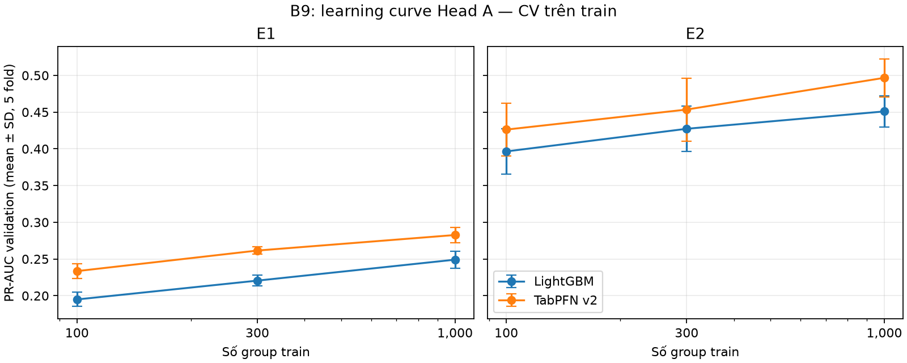

# B9 / X7 — TabPFN v2 và LightGBM trên Head A train

Chạy 12/11 trên Modal Tesla T4; 5 outer fold forward-chaining, tập test khóa không mở. Hai mô hình dùng cùng 21 đặc trưng T1/T2 của A, cùng nhóm train và validation trong mỗi fold; các mức là **số group**, không phải số dòng. Kết quả là mean ± SD giữa 5 fold; Δ là hiệu số PR-AUC TabPFN − LightGBM theo cặp cùng fold, **không phải CI**.

| Dataset | Group train | LightGBM PR-AUC | TabPFN PR-AUC | Δ theo cặp |
|---|---:|---:|---:|---:|
| E1 | 100 | 0.195 ± 0.010 | 0.234 ± 0.010 | +0.039 ± 0.005 |
| E1 | 300 | 0.221 ± 0.007 | 0.262 ± 0.005 | +0.041 ± 0.005 |
| E1 | 1.000 | 0.249 ± 0.012 | 0.283 ± 0.010 | +0.034 ± 0.006 |
| E2 | 100 | 0.397 ± 0.031 | 0.426 ± 0.036 | +0.030 ± 0.010 |
| E2 | 300 | 0.427 ± 0.031 | 0.453 ± 0.043 | +0.026 ± 0.025 |
| E2 | 1.000 | 0.451 ± 0.021 | 0.497 ± 0.026 | +0.046 ± 0.006 |

Trong các mức này, TabPFN có PR-AUC trung bình cao hơn LightGBM. Đây là kết quả CV train với một mẫu group cho mỗi fold, không chứng minh tốt hơn trên held-out test hoặc ở quy mô lớn. Các mức group do B chọn cho X7, chờ A review; chưa thực hiện calibration hay đánh giá test.

Biểu đồ sinh lại bằng `python -m src.m3_health.report_tabpfn_b9`; thanh sai số là SD giữa fold, **không phải khoảng tin cậy**.

## Paired cluster bootstrap trên OOF

Lần chạy lại lưu dự đoán OOF và tái lập chính xác PR-AUC từng fold của lần đầu. Với mỗi fold, lấy lại `group_id` có hoàn lại độc lập trong fold; hai mô hình dùng cùng trọng số group. Thống kê là trung bình không trọng số của 5 hiệu số PR-AUC fold, B = 2.000, seed = 42, CI percentile 95%; 2.000/2.000 lần hợp lệ cho mọi mức.

| Bộ | Group train | Δ TabPFN − LightGBM | CI 95% |
|---|---:|---:|---:|
| E1 | 100 | +0.0386 | [0.0354, 0.0417] |
| E1 | 300 | +0.0410 | [0.0379, 0.0442] |
| E1 | 1.000 | +0.0336 | [0.0302, 0.0372] |
| E2 | 100 | +0.0297 | [0.0258, 0.0335] |
| E2 | 300 | +0.0262 | [0.0221, 0.0302] |
| E2 | 1.000 | +0.0457 | [0.0418, 0.0498] |

CI **có điều kiện theo các mô hình, fold thời gian và tập train đã chọn**, không tính bất định do fit lại hay do chọn group train; không phải CI trên test độc lập. CSV chi tiết là `B9_E1_ci.csv`, `B9_E2_ci.csv`. Dự đoán OOF chứa nhãn/group train, giữ ở Modal `/b9/results-oof/` và thư mục tạm local, không commit Git. Tái lập bằng `python -m src.m3_health.bootstrap_tabpfn_b9 --input <oof.parquet> --output <ci.csv>`.

**Chi phí suy luận:** trung bình mỗi fold ở mức 1.000 group: E1 TabPFN 126,0 s so với LightGBM 0,14 s; E2 15,8 s so với 0,046 s. Đây là thời gian dự đoán toàn bộ validation fold, TabPFN GPU T4 so với LightGBM CPU, không phải latency một mẫu và không phải benchmark cùng thiết bị.

Giao thức chi tiết, checkpoint và giới hạn: `docs/B9_TABPFN.md`. Kết quả từng fold và metadata: `B9_E1.csv`, `B9_E1.json`, `B9_E2.csv`, `B9_E2.json` cùng thư mục. Hash đầu vào train local khớp metadata; runner SHA-256 `5cf9217b24c7304debe5134d7e725310224e306a819163acd3509df4df7f8a3b`; checkpoint SHA-256 `f65a35685aeef42e31b796d9bfa34e68d6fc780bc98e7bff7763802964cf435f`. Git commit trong metadata là **commit cơ sở**, không bao gồm runner chưa commit; runner hash định danh đúng code chạy, không được mô tả nhầm là code của commit đó.

Ledger có 12 dòng B9 (mỗi bộ × mức × mô hình), phản ánh lần chạy ngày 12/11. Trường `git_commit` là commit cơ sở và được ghi rõ trong `notes`; runner được định danh thêm bằng SHA-256 ở trên. `data_hash` là 12 ký tự đầu SHA-256 của JSON sắp khóa chứa hai SHA-256 input ghi trong metadata, không phải hash trực tiếp của file parquet. `config_hash` bao gồm config A, mức group, batch, danh sách đặc trưng, phiên bản TabPFN và hash checkpoint.

Bản runner gốc được lưu tại `B9_runner_20261112.py` và khớp hash nêu trên. Metadata lần chạy lại được lưu ở `B9_E1_rerun.json` và `B9_E2_rerun.json`; hash runner lần chạy lại `8e90b0c4fd0f923fc75a87e2bdfedf31dc4095d2ca2d072478193b9ed6b4884c`, khớp `src/m3_health/run_tabpfn_b9.py` khi chạy. Cả hai runner chưa được commit tại thời điểm chạy; kết quả, ledger và CI cần A review.
